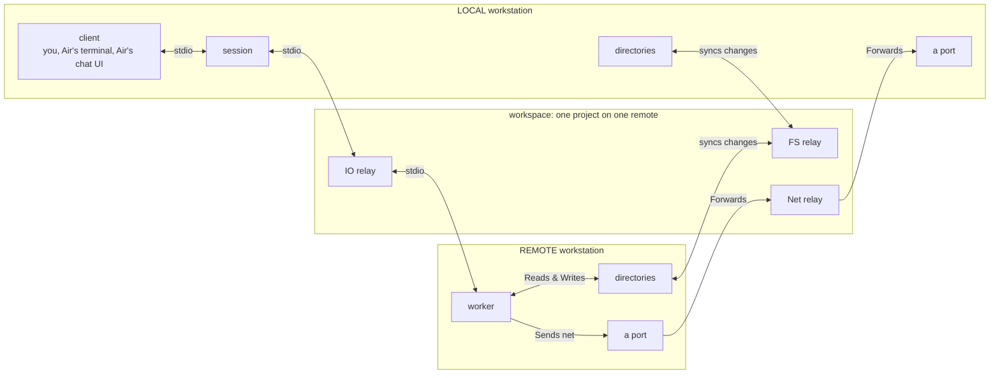
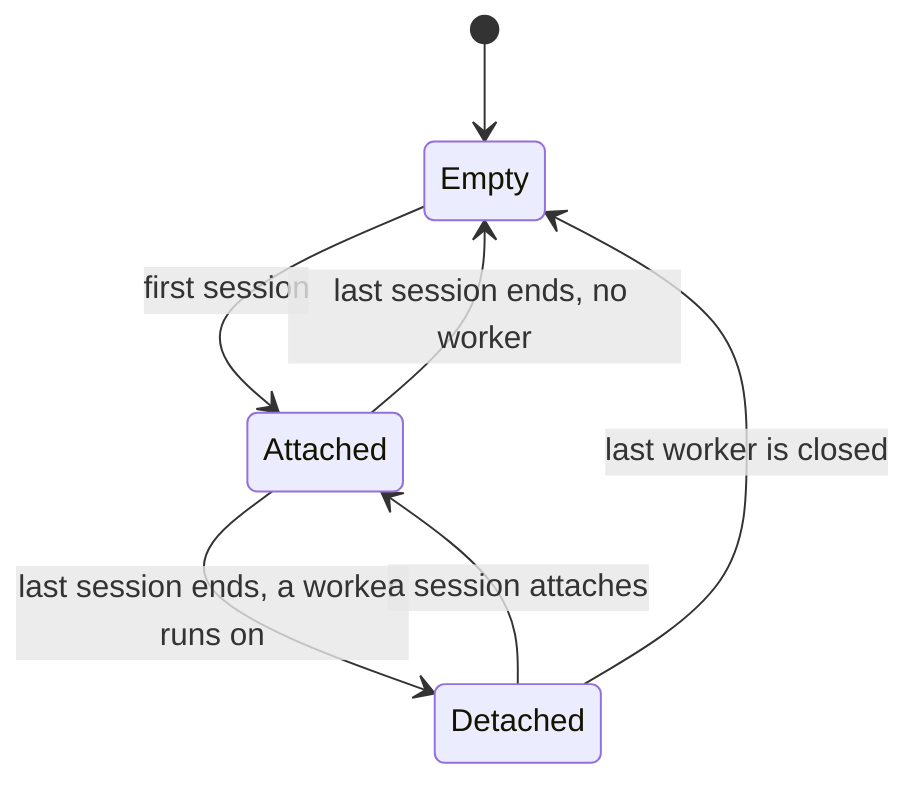
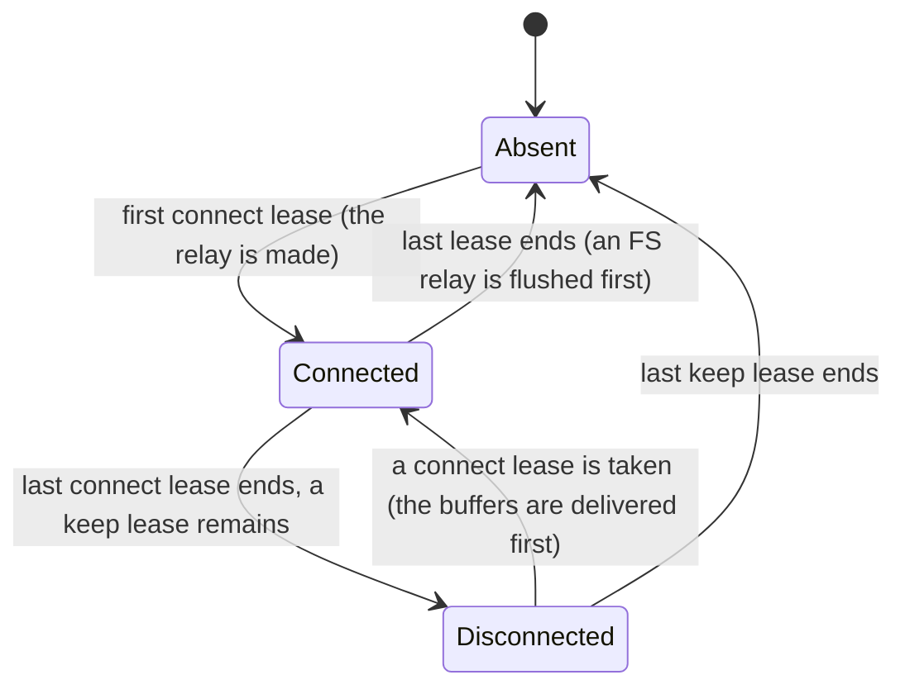
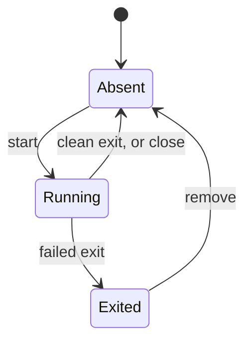
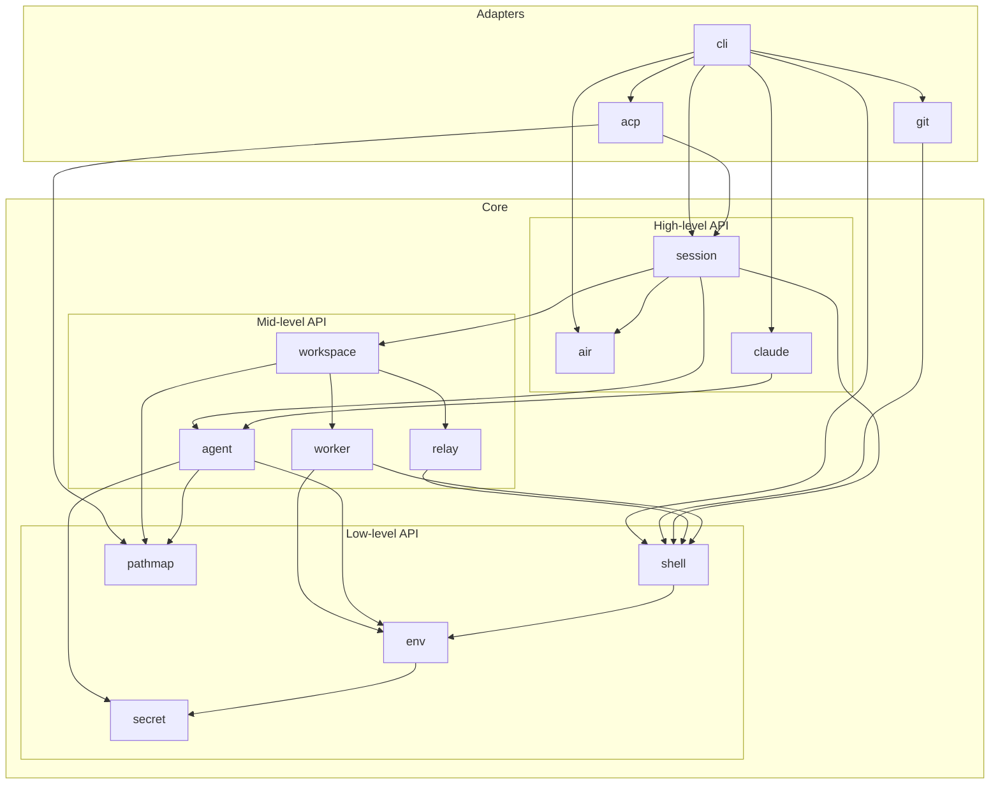
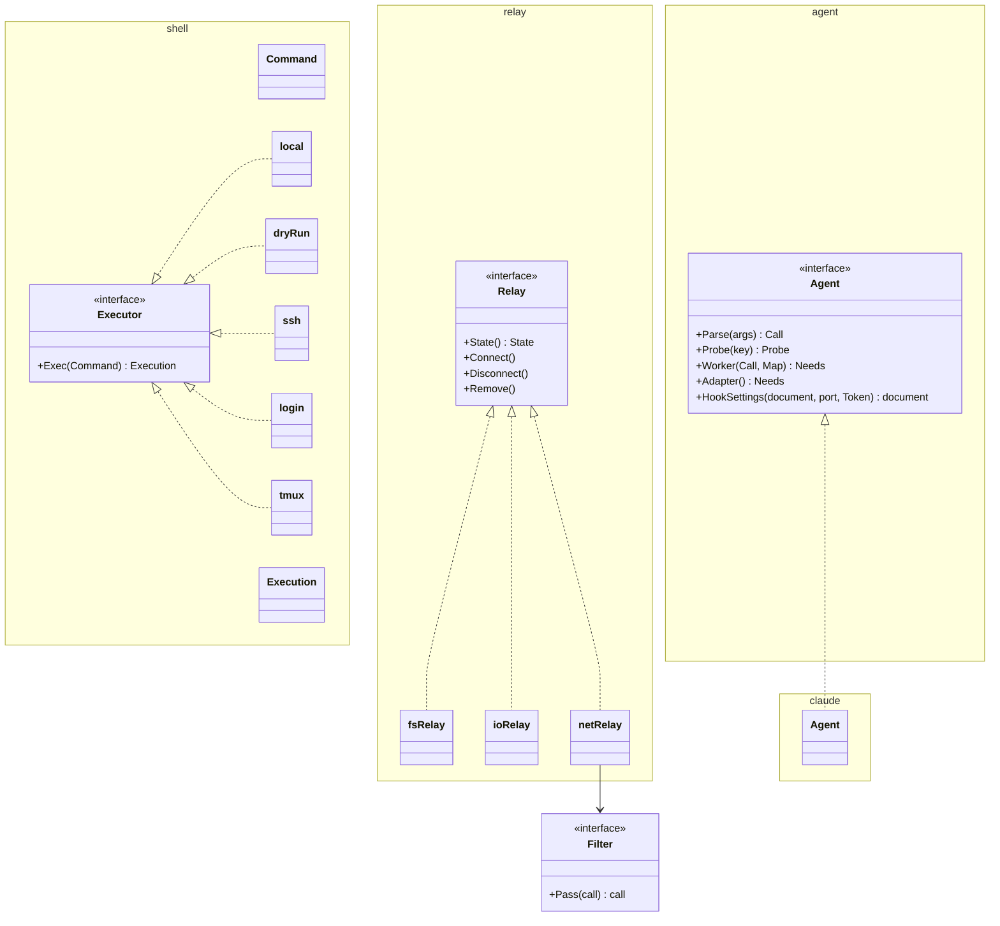
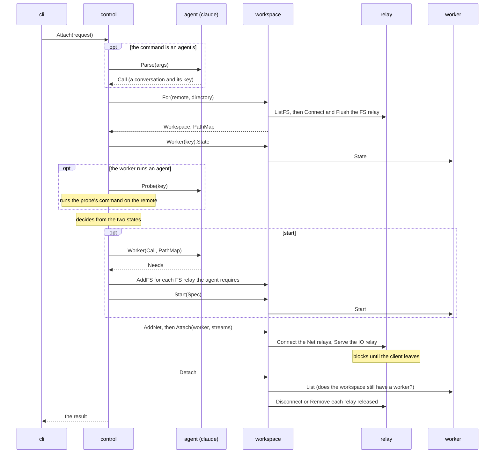
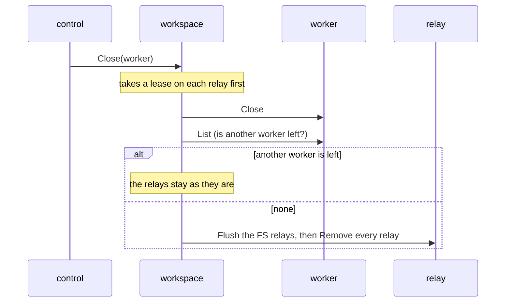
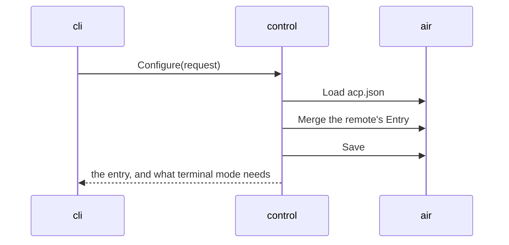

# Hermod — Architecture

This document describes **what Hermod is built from**: its entities and their states, the packages, the types and
interfaces each package declares, and which package calls which in every flow.

Hermod is small on purpose. It composes Mutagen, ssh and tmux, and for JetBrains Air the ACP adapter, into one
command. It keeps no second copy of any state: each state has one store, which is read every time the state is
needed. [Storage](#storage) lists the stores, most of them the tools' own.

## The model

> A **session** attaches a local client to a **workspace** on a remote: the **relays** that carry files, stdio and
> calls between the two workstations, and the **workers** that keep running there when the client is gone.



## Entities

Every entity owns one thing, and one package represents the entity. No other package restates what it owns or
decides by it.

| Entity                      | What it owns                                                                     | Identified by                                                             | Lives until                                            |
|-----------------------------|----------------------------------------------------------------------------------|---------------------------------------------------------------------------|--------------------------------------------------------|
| [Workstation](#workstation) | A machine commands run on: the local one, or the remote                          | its host                                                                  | —                                                      |
| [Session](#session)         | One attachment of a local Hermod process to one workspace and one of its workers | the process and the workspace                                             | the process releases it, or ends                       |
| [Workspace](#workspace)     | The relays and the workers of one project on one remote                          | the remote and the project's root directory                               | — (it is Empty when it has no relay and no worker)     |
| [Relay](#relay)             | One channel between the two workstations, and whether it is connected            | its kind and its two ends                                                 | its last lease is released                             |
| [Worker](#worker)           | One persistent process on the remote                                             | a key: the agent's session ID, a name, or `acp` for a workspace's adapter | the remote process is gone                             |
| [Agent](#agent)             | One conversation of the agent program, and that program's contract               | the agent's own session ID                                                | the client ends the conversation, or the program exits |

### Workstation

A workstation is a machine with a shell: the **local** one, where the client and Hermod run, and the **remote**,
where the work runs. Hermod reaches workstations by running commands there using `shell`.

| Workstation | What is there                                                                                                     |
|-------------|-------------------------------------------------------------------------------------------------------------------|
| Local       | the client, the Hermod process, the Mutagen daemon, the lock files, the listener of every Net relay               |
| Remote      | the project's directories, the tmux server and its workers, the agent program and its adapter, each worker's logs |

Hermod runs no process of its own on the remote: everything there is tmux, the agent program or a
[script](#remote-scripts) a worker was started with.

### Session

A session is one attachment: a local Hermod process, holding the relays of one workspace Connected and one of its
workers attached to the client. It is a running function of the `session` package, and nothing records it.

- A session takes a **connect lease** on every relay it uses ([Leases](#leases)).
- A session ends when its process releases it (the client leaves, the worker exits, a chat's last tab is closed)
  or when the process dies. Either way its leases end with it.
- A session that ends changes no worker's state: the worker runs on.
- `hermod attach` and the stand-in hold one session. `hermod air acp` holds one for every workspace that has a
  chat open, and keeps in memory which chat belongs to which.

A session has no states of its own: while it exists it is attached.

### Workspace

A workspace is the relays and the workers of one project on one remote. Its identity is the remote and the
project's root directory, so it is neither created nor removed: a project that Hermod has never touched, or has
finished with, has an Empty workspace. The `workspace` package represents it, and is the only package that pairs
relays with workers.

| State    | Meaning                                                                               |
|----------|---------------------------------------------------------------------------------------|
| Empty    | No relay and no worker. Before the first session, and after the last worker is gone.  |
| Detached | No session holds it: its workers run on, and the relays they lease are Disconnected.  |
| Attached | At least one session holds it: the relays that session leases are Connected.          |

A workspace's state is computed from its members every time and never kept. Which root a directory belongs to,
and how relays enter a workspace, are in the [design](../openspec/changes/add-air-bridge/design.md#workspace).



### Relay

A relay is one channel between the two workstations. The `relay` package represents it: three kinds behind one
set of states.

| Kind | Carries                                                                  | Mechanism                                              | What Disconnected buffers, and where                               |
|------|--------------------------------------------------------------------------|--------------------------------------------------------|--------------------------------------------------------------------|
| FS   | files between two directories                                            | a Mutagen session                                      | file changes, on each side's disk                                  |
| IO   | one worker's stdin, stdout and stderr                                    | tmux for a terminal; a FIFO and logs for a line stream | output and the agent's questions: in tmux's screen, or in the logs |
| Net  | calls from a remote port to a local address, optionally through a filter | `ssh -R` to a local listener                           | nothing: a Net relay goes from Connected to Absent                 |

Each relay has one of the following states, and its leases decide which:

| State        | Leases on the relay        | Meaning                                                                                    |
|--------------|----------------------------|--------------------------------------------------------------------------------------------|
| Absent       | none                       | No relay: nothing is exchanged and nothing is buffered.                                    |
| Disconnected | keep leases only           | The relay exists and delivers nothing. Each end accepts what arrives there and buffers it. |
| Connected    | at least one connect lease | Both ends exchange continuously. The pace is the mechanism's and the network's.            |



#### Leases

A lease is a claim on a relay that ends with the process that makes it. A relay and its leases do not know who
that is: the entity that takes a lease says so in its own section.

| Lease   | Claims that the relay        | Is                                                                                         | Ends when                                                    |
|---------|------------------------------|--------------------------------------------------------------------------------------------|--------------------------------------------------------------|
| Connect | delivers                     | a shared lock on the relay's lock file, `$XDG_RUNTIME_DIR/hermod/lease/<relay>`, held by a local process | the process unlocks it, or dies and the kernel unlocks it |
| Keep    | exists, and buffers          | the workspace tag on a tmux session on the remote, which claims that workspace's FS relays and the session's own IO relay | the tmux session is gone |

- **No lease is left behind.** Neither kind is a record someone must remember to delete: a killed process holds
  no lock, and a tmux session that is gone carries no tag.
- **`workspace` is the only package that sees a lease.** It takes and releases the locks and counts the tags.
  `relay` connects, disconnects and removes what it is told to.
- **The last one out settles.** A process that releases a connect lease tries to lock the file exclusively,
  without waiting. If it gets the lock, no other connect lease is left: it counts the keep leases, then
  disconnects the relay or removes it. Closing a tmux session settles its relays the same way.
- **Unknown means keep.** When the keep leases cannot be counted (the remote does not answer), the relay is left
  Disconnected, which never removes something in use.
- **A keep lease can end with nobody there.** The relay then stays Disconnected until the workspace's next
  session settles it.
- **A Net relay takes connect leases only.** Its local end is a listener inside the process that connected it,
  so nothing could buffer for it and it has no Disconnected state.

A lock was chosen over a local daemon that owns the relays because `hermod attach` has no process that outlives
it to be one.

### Worker

A worker is one process on the remote that outlives its clients: a tmux session running a plain command, one
agent, or an adapter that runs an agent per chat. The `worker` package represents it and knows nothing about what
the process is.

| State   | Meaning                                                                 |
|---------|-------------------------------------------------------------------------|
| Absent  | No tmux session under the key.                                          |
| Running | The process is alive.                                                   |
| Exited  | The process failed; its pane is kept to show the error and exit status. |



While its tmux session exists, Running or Exited, a worker is a **keep lease** on its IO relay and on its
workspace's FS relays ([Leases](#leases)).

### Agent

An agent is two things under one name: one conversation of an agent program, and the contract that program
offers Hermod. The `agent` package declares the contract and `claude` implements it for Claude Code.

| State   | Meaning                                                                                                                             |
|---------|-------------------------------------------------------------------------------------------------------------------------------------|
| Running | The agent program lists the conversation as running: it works on the last message or waits for the next one.                        |
| Stopped | The conversation was ended: the client asked the agent to end it, or the program exited. Its transcript stays and can be resumed.   |


Leaving is not ending. A client that detaches (a closed terminal, a closed chat tab, a lost connection) leaves
the agent Running, and what the agent asks meanwhile waits in its IO relay.

An agent performs nothing. It answers `session` with values: the command a worker needs, the files and relays
that command requires, and the command that asks the agent program for a conversation's state. `session` hands
the first to `workspace` as an ordinary worker to start and runs the last through `shell` on the remote, so
neither `workspace` nor `worker` has an operation that names a conversation.

## Storage

Every state has one store and is read from there every time it is needed. Hermod keeps no second copy, so there
is nothing to drift.

| State                                                   | Stored in                                                                     | Read with                                            | Read by                                                          |
|---------------------------------------------------------|-------------------------------------------------------------------------------|------------------------------------------------------|------------------------------------------------------------------|
| Which FS relays exist, their ends and whether they sync | Mutagen                                                                       | `mutagen sync list`, by label                        | **Relay**, asked by **Workspace**                                |
| Which workers exist, their state and workspace          | tmux on the remote                                                            | `tmux ls`, by tag                                    | **Worker**, asked by **Workspace**                               |
| Whether a conversation runs                             | the agent program                                                             | `claude agents --json`                               | **Session**, with the command and the reading **Agent** declares |
| A relay's connect leases                                | the kernel, as locks on the relay's lock file on the local workstation        | trying to take the lock exclusively, without waiting | **Workspace**                                                    |
| A relay's keep leases                                   | tmux on the remote, as workspace tags                                         | `tmux ls`, by tag                                    | **Worker**, asked by **Workspace**                               |
| What a Disconnected IO relay buffers                    | tmux's screen, or the logs in the worker's directory on the remote            | joining the tmux session, or reading the logs        | **Relay**                                                        |

Two of these stores are files Hermod writes itself:

| File                  | Where                                   | Holds                                                                                        |
|-----------------------|-----------------------------------------|----------------------------------------------------------------------------------------------|
| A lock file per relay | local, `$XDG_RUNTIME_DIR/hermod/lease/` | Nothing: the state is the lock on it, which the kernel holds. The file itself may be left.   |
| A worker's directory  | remote                                  | A line stream's FIFO and logs, and the files the process was started with (its settings).    |

## Packages

| Package     | Represents                                           | Constraints                                                                                                                                                                                                      | Declares                                                                     |
|-------------|------------------------------------------------------|------------------------------------------------------------------------------------------------------------------------------------------------------------------------------------------------------------------|------------------------------------------------------------------------------|
| `cli`       | the process's interface | The only package that reads the arguments, the environment and the process's streams, and the one place every variable Hermod reads is named. Builds everything a command needs from outside the core and hands it in: the agent implementation, the shells, the developer's git facts, the ACP connection. Decides nothing from a state. | the commands |
| `session`   | [Session](#session) | The only package that decides from states: what to do for a pair of agent and worker states, and where a chat's message goes. Reaches relays and workers only through `workspace`, and an agent only through `agent.Agent`. Declares the messages it routes and the channel they arrive on, and never the wire format. Keeps nothing past the process. | `Attach`, `Chat`, `ExitStatus`, `Message`, `Channel` |
| `workspace` | [Workspace](#workspace), [Leases](#leases)           | The only package that pairs relays with workers, names and tags them, and takes a lock. Its state is computed on every call.                                                                                     | `Workspace`, `State`, `Members`                                              |
| `relay`     | [Relay](#relay)                                      | Mechanism only: holds no lease and decides nothing. FS runs the `mutagen` command; Net runs `ssh -R` and a listener in this process; IO copies between a worker's stdio and the client's streams.                 | `Relay`, `State`, `FS`, `IO`, `Net`, `Ends`, `Filter`                        |
| `worker`    | [Worker](#worker)                                    | Mechanism only: builds tmux commands and runs them through a `shell` on the remote. Does not know what its process is. Holds the [scripts](#remote-scripts) a worker starts with.                                 | `Worker`, `State`, `Spec`, `Form`, `Stdio`, `List`                           |
| `agent`     | [Agent](#agent), the contract                        | An interface and values. No behaviour, and no dependency but the shared packages.                                                                                                                                | `Agent`, `State`, `Call`, `Probe`, `Needs`                                   |
| `claude`    | [Agent](#agent), for Claude Code                     | Pure functions: runs no command and reads no file. The only package that knows Claude Code's arguments, files and adapter.                                                                                       | `Agent` (implements `agent.Agent`)                                           |
| `acp`       | the ACP wire format | Reads and writes one message per line, and turns each into the `session.Message` it is routed by. Routes nothing itself. | `Conn` (implements `session.Channel`) |
| `air`       | JetBrains Air's own facts                            | The only package that knows the `acp.json` document, the stand-in link and the names of Air's own ACP messages. Writing `acp.json` keeps every entry and key it does not own.                                     | `Configure`, `Config`, `Entry`, `Archive`, `Unarchive`                       |
| `git`       | the developer's git facts | Read-only `git` commands on the local workstation. Called by `cli`, which passes the results on as values. | `Identity`, `Read`, `MainWorktree` |
| `shell`     | [Workstation](#workstation)                          | The only package that starts a process. Each wrapper rewrites the command and hands it inward, and dry-run is chosen once at the innermost one.                                                                  | `Shell`, `Command`, `Result`; `Local`, `DryRun`, `SSH`, `LoginShell`, `Tmux` |
| `pathmap`   | the map between local and remote paths               | Pure. Applies to a string or a JSON value, longest root first.                                                                                                                                                   | `Map`, `Place`                                                               |
| `env`       | variables as pairs                                   | The one place that splits and joins `KEY=VALUE`.                                                                                                                                                                 | `Vars`                                                                       |
| `secret`    | a value that must not be printed                     | A token prints as a mask everywhere but where it is delivered.                                                                                                                                                   | `Token`                                                                      |

### Package dependencies



Every arrow is a direct import. An adapter imports the core and the core imports no adapter; inside the core, a
package imports only its own level or a lower one.

- `git` and `acp` are adapters because each speaks to something outside Hermod's model: the `git` command, and a
  wire protocol. `cli` runs `git` and passes the developer's identity and a worktree's main working tree into
  the core as values. `acp` implements the channel that `session` declares.
- `air` and `claude` are in the core because `session` decides by what they declare: Air's own message names, and
  the agent's contract.

### Remote scripts

A worker starts through a shell script on the remote: one that keeps a failed process's pane, and one that gives
a line stream its FIFO and logs. Each script is a file embedded in the `worker` package and is sent to the
remote's `sh` on its standard input when it is run, so nothing of Hermod's is installed there. A script takes its
inputs as arguments and environment, and nothing is substituted into its text: it reads the same in the
repository as on the remote.

## Interfaces

An interface is declared where it has more than one implementation or where a package must not know who implements
it. Everything else is a concrete type, tested through a fake `Shell`.



### `shell.Shell` — a workstation

One method: run one `Command` and return its `Result`. A `Command` is built once and carries the argv, the
directory, the variables, the streams and how to stop it.

| Implementation | What it is                                                             |
|----------------|------------------------------------------------------------------------|
| `Local`        | Runs the command on this machine.                                      |
| `DryRun`       | Prints the command as a line that can be pasted, and runs nothing.     |
| `SSH`          | Wraps an inner `Shell`: the command runs on a host.                    |
| `LoginShell`   | Wraps an inner `Shell`: the command runs under the user's login shell. |
| `Tmux`         | Wraps an inner `Shell`: the command runs in a tmux session.            |

The first two say **how** a command runs and the other three **where**. A caller nests the ones it needs, and the
choice between `Local` and `DryRun` is made once, at the bottom, so no code above it knows about dry-run. Reads
that shape the plan (states, git identity) always use `Local`.

### `relay.Relay` — one channel

| Method       | What it does                                                                            |
|--------------|-----------------------------------------------------------------------------------------|
| `State`      | Reads the relay's state from its mechanism. A read that fails is an error, not a state. |
| `Connect`    | Makes the relay if Absent, and takes it to Connected.                                   |
| `Disconnect` | Takes it to Disconnected.                                                               |
| `Remove`     | Takes it to Absent.                                                                     |

| Implementation | Constructed from                                        | Adds                                                                    |
|----------------|---------------------------------------------------------|-------------------------------------------------------------------------|
| `FS`           | `Ends` (a local root and a remote root), a name, labels | `Flush`; `ListFS`, which reads the relays under a label with their ends |
| `IO`           | a `worker.Stdio` value and the client's streams         | `Serve`, which copies between them until the client leaves              |
| `Net`          | a remote port, a local address, an optional `Filter`    | —                                                                       |

`relay` connects, disconnects and removes what it is told to. It holds no lease and decides nothing.

### `relay.Filter` — what a Net relay lets through

One method: given a call that arrived on the remote port, return the call to make locally, or refuse it. `relay`
declares it and knows no implementation. `control` builds the one for an agent's hooks from what the agent
declared; a user's `-R` relay has none.

### `agent.Agent` — an agent program's contract

`control` reaches an agent only through this interface, and `cli` chooses the implementation from the command
line. Every method is a question answered with a value; an agent performs nothing.

| Method         | Control asks                            | The agent answers with                                                                                                                          |
|----------------|-----------------------------------------|-------------------------------------------------------------------------------------------------------------------------------------------------|
| `Parse`        | What do these arguments ask for?        | a `Call`: a conversation and its key, or a one-shot call                                                                                        |
| `Probe`        | Is this conversation running?           | a `Probe`: the command that asks the agent program, and how to read its output into a `State`                                                   |
| `Worker`       | What does a worker for this call need?  | a `Needs`: the command with paths mapped, the files it must find, the names of the local variables it must be given, and the relays it requires |
| `Adapter`      | What does its ACP adapter need?         | a `Needs` of the same shape                                                                                                                     |
| `HookSettings` | How do its hook settings reach a relay? | the settings document with its hooks aimed at a remote port and carrying the worker's token                                                     |

An agent is handed a `pathmap.Map` and never learns where the other workstation is or how it is reached.

### Concrete types

| Type                  | Operations                                                                                                                                                 | Notes                                                                                                                                     |
|-----------------------|------------------------------------------------------------------------------------------------------------------------------------------------------------|-------------------------------------------------------------------------------------------------------------------------------------------|
| `workspace.Workspace` | `For` (the workspace a directory belongs to, made if there is none), `State`, `PathMap`, `AddFS`, `AddNet`, `Worker`, `Start`, `Attach`, `Detach`, `Close` | The only type that pairs relays with workers. `Detach` and `Close` apply the release rule. Leases are its own detail.                     |
| `worker.Worker`       | `State`, `Start`, `Close`, `Remove`, `Stdio`; `List` by tag                                                                                                | `Spec` says what to start: key, directory, command, files, variables, tags and the IO `Form` (terminal or line stream).                   |
| `acp.Conn`            | `Read`, `Write`                                                                                                                                            | One message per line. A `Message` gives its method, its ID, the chat it belongs to and the directory it names, and takes a `pathmap.Map`. |
| `air.Config`          | `Load`, `Merge`, `Save`                                                                                                                                    | Merging keeps every entry and key it does not own.                                                                                        |
| `pathmap.Map`         | `ToRemote`, `ToLocal`                                                                                                                                      | Built from the ends of a workspace's FS relays, longest prefix first.                                                                     |

## Flows

The steps and their rules are in the [design](../openspec/changes/add-air-bridge/design.md#flows). The diagrams
here show which package does each step.

### Session: `hermod attach`, and `claude` on a terminal



### One-shot call


No workspace, no worker and no relay take part.

### Chat: `hermod air acp`

```mermaid
sequenceDiagram
    participant Air
    participant control
    participant acp
    participant agent as agent (claude)
    participant workspace
    participant adapter as adapters on the remote
    Air ->> control: starts Chat(request) through cli
    control ->> agent: Adapter()
    agent -->> control: Needs
    control ->> adapter: starts its own adapter over ssh (no worker)
    Air ->> control: initialize
    control ->> acp: Read, drop the fs and terminal capabilities
    control ->> adapter: initialize, to its own adapter
    adapter -->> Air: the answer
    Air ->> control: session/new (a directory)
    control ->> workspace: For(remote, directory)
    control ->> workspace: Worker(acp).State
    opt Absent
        control ->> workspace: Start(Spec for the adapter), AddNet for its hooks
        control ->> adapter: the kept initialize
    end
    control ->> workspace: Attach(worker, a line stream)
    control ->> adapter: session/new, paths mapped to the remote
    adapter -->> control: answer and updates
    control -->> Air: the same, paths mapped back, requests renumbered
    Air ->> control: session/close (a closed tab)
    control -->> Air: the answer; nothing is passed on
    opt it was the workspace's last open chat
control->>workspace: Detach (the Net relay is kept)
end

Air->>control: _session/archive (mark done)
control->>adapter: session/close, then the archive
opt the adapter runs no other chat
control->>workspace: Close(worker)
end

Air->>control: stdin EOF or SIGTERM
control->>workspace: Detach, for every workspace it holds
```

`control` holds one session per workspace that has a chat open and keeps, only while it runs, which chat belongs
to which workspace and which request ID it gave to which adapter. Neither is stored: after a restart a chat's
workspace is found again from the directory its `session/load` names.

### Close



### Registration: `hermod air configure`



## The command-line seam

`cli` is the only package that reads the process: its arguments, its environment, its streams and the name it was
started under. It resolves each value once, an argument winning over its variable, builds one request, picks the
agent implementation the command names, and calls one use case. Started as `claude`, the binary builds the same
request `hermod attach -- claude ARGS…` builds. No package below `cli` imports the command-line framework or looks
at the environment.
