# Hermod — Architecture

This document describes **what Hermod is built from**: its components and their states, the packages, the types and
interfaces each package declares, and which package calls which in every flow.

Hermod is small on purpose. It composes Mutagen, ssh and tmux, and for JetBrains Air the ACP adapter, into one
command. It keeps no second copy of any state: each state has one store, which is read every time the state is
needed. [Storage](#storage) lists the stores, most of them the tools' own.

## The model

> A **session** attaches a local client to a **workspace** on a remote: the **relays** that carry files, stdio and
> calls between the two workstations, and the **workers** that keep running there when the client is gone.

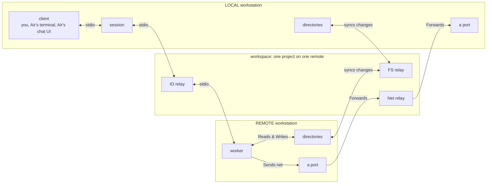

## Components

The components of the model, from the one that drives a command down to what everything runs on. Each section
describes its component in its own terms and in terms of the components below it, never of those above. Every
component has a limited responsibility, and one package represents it.

### Session

A session is one attachment of a client: a local Hermod process that holds the relays of one workspace Connected
and joins the client to one of that workspace's workers. It is a running function of the `session` package.
Nothing records it, and it has no states: while it exists it is attached.

- **It decides.** A session reads the worker's state and, when the worker runs an agent, the agent's, and chooses
  what to do from the pair: start, resume, join, or refuse.
- **It uses an agent as values.** It asks the agent what a conversation needs, hands the answer to the workspace
  as an ordinary worker to start, and runs the agent's queries through `shell` on the remote. Nothing below a
  session knows what a conversation is.
- **It leases what it uses.** A session takes a connect lease on every relay it uses, through the workspace, and
  those leases end with it.
- **Leaving ends only the session.** A session ends when its client leaves (a closed terminal, a closed chat tab,
  a lost connection), when the worker exits, or when the process dies. The worker runs on, and an agent it runs
  stays Running.
- **One per workspace in use.** `hermod attach` and the stand-in hold one session. `hermod air acp` holds one for
  every workspace that has a chat open, and keeps in memory which chat belongs to which while it holds that
  workspace; the agent program says where any other chat belongs.

### Workspace

A workspace is the relays and the workers of one project on one remote. Its identity is the remote and the
project's root directory, so it is neither created nor removed: a project that Hermod has never touched, or has
finished with, has an Empty workspace. The `workspace` package represents it, and is the only package that puts
relays and workers together.

- **One name.** It names its relays and tags its workers after itself, so everything of one project on one remote
  is found again by that name.
- **Relays are connected and detached together.** Connecting takes a connect lease on each relay for the caller,
  and detaching gives them up.
- **Its workers keep its relays.** When the caller detaches, the workspace reads its workers. While one
  remains, it suspends the leases and the relays stay Disconnected; with none left, it releases them and the relays
  are removed. Workers that cannot be read count as running, which never removes something in use.
- **The path map.** The two ends of its FS relays, longest root first, are the map between local and remote
  paths.

| State    | Meaning                                                                                  |
|----------|------------------------------------------------------------------------------------------|
| Empty    | No relay and no worker.                                                                  |
| Detached | It has a worker or a relay, and no relay of its has a connect lease: they are Disconnected. |
| Attached | A connect lease is held on its relays: they are Connected.                               |

A workspace's state is computed from its relays and workers every time and never kept. Which root a directory
belongs to, and how relays enter a workspace, are in
[Which workspace a directory belongs to](#which-workspace-a-directory-belongs-to) and
[How relays enter a workspace](#how-relays-enter-a-workspace).

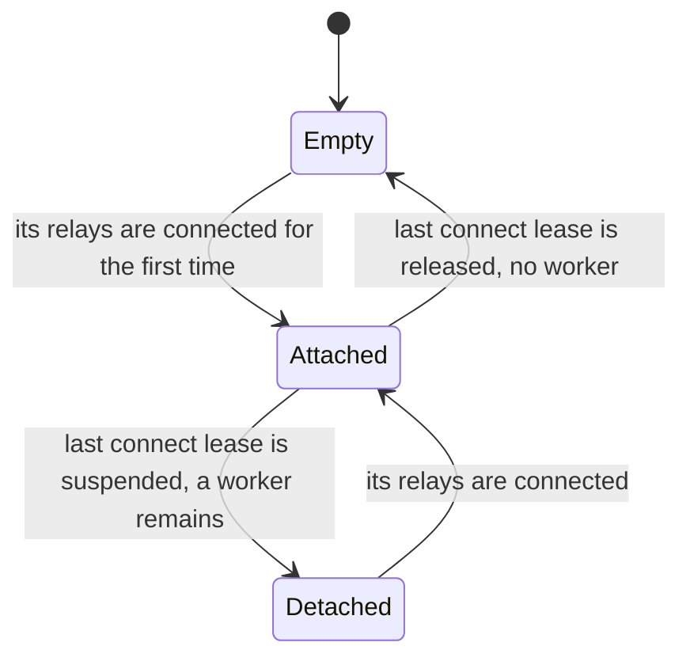

### Relay

A relay is one channel between the two workstations, identified by its kind and its two ends. The `relay`
package represents it, with its leases: three kinds behind one set of states.

| Kind | Carries                                                                  | Mechanism                                                        | What Disconnected buffers, and where            |
|------|--------------------------------------------------------------------------|------------------------------------------------------------------|-------------------------------------------------|
| FS   | files between two directories                                            | a Mutagen session                                                | file changes, on each side's disk               |
| IO   | the stdin, stdout and stderr of one process on the remote                | copies between local streams and a remote stdio it is handed     | what the process writes, at the remote stdio    |
| Net  | calls from a remote port to a local address, optionally through a filter | `ssh -R` to a local listener                                     | nothing: a Net relay goes from Connected to Absent |

Each relay has one of the following states, and its leases decide which:

| State        | Leases on the relay        | Meaning                                                                                    |
|--------------|----------------------------|--------------------------------------------------------------------------------------------|
| Absent       | none                       | No relay: nothing is exchanged and nothing is buffered.                                    |
| Disconnected | none: the last was suspended, or its process died | The relay exists and delivers nothing. Each end accepts what arrives there and buffers it. |
| Connected    | at least one connect lease | Both ends exchange continuously. The pace is the mechanism's and the network's.            |

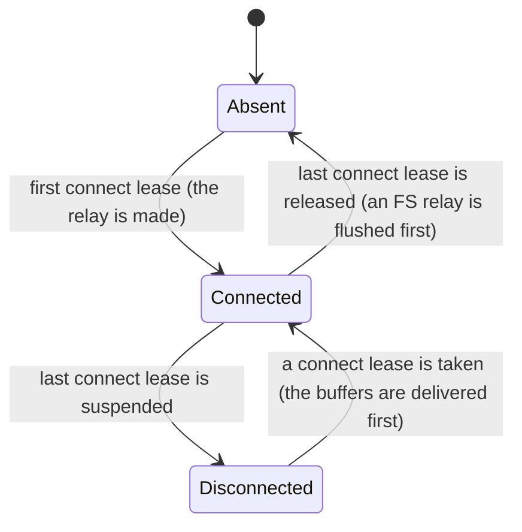

#### Leases

A lease is a claim on a relay. A relay counts its leases and knows nothing else about who holds them or why.

| Lease   | Claims that the relay | Is                                                                                                       | Ends when                                                                 |
|---------|-----------------------|----------------------------------------------------------------------------------------------------------|---------------------------------------------------------------------------|
| Connect | delivers              | a shared lock on the relay's lock file, `$XDG_RUNTIME_DIR/hermod/lease/<relay>`, held by a local process | the process suspends or releases it, or dies and the kernel unlocks it    |

Whoever holds a lease says how it is given up, and the relay acts on that only when it was the last:

| Giving up | The relay, when it was the last lease                          |
|-----------|----------------------------------------------------------------|
| Suspend   | stays, Disconnected: it exists and buffers                     |
| Release   | is removed, Absent; an FS relay is flushed first               |

- **No lease is left behind.** A lease is not a record someone must remember to delete: a killed process holds no
  lock.
- **The last one out settles.** A process that gives up a connect lease tries to lock the file exclusively,
  without waiting. If it gets the lock, no other connect lease is left: the relay disconnects or removes itself,
  as the holder chose.
- **Only a lease given up settles a relay.** A relay whose last lease was suspended, or whose process died, stays
  Disconnected until it is next connected, and the lease taken then decides again when it is given up.
- **A Net relay is never Disconnected.** Its local end is a listener inside the process that connected it, so
  nothing could buffer for it: suspending its last lease removes it, as releasing does.

A lock was chosen over a local daemon that owns the relays because not every Hermod command has a process that
outlives it to be one.

### Worker

A worker is one process on the remote that outlives whoever started it: a tmux session running a command. It is
identified by a key its caller chooses, and carries the tags its caller gives it. The `worker` package represents
it and knows nothing about what the process is or who it is for.

| State   | Meaning                                                                 |
|---------|-------------------------------------------------------------------------|
| Absent  | No tmux session under the key.                                          |
| Running | The process is alive.                                                   |
| Exited  | The process failed; its pane is kept to show the error and exit status. |

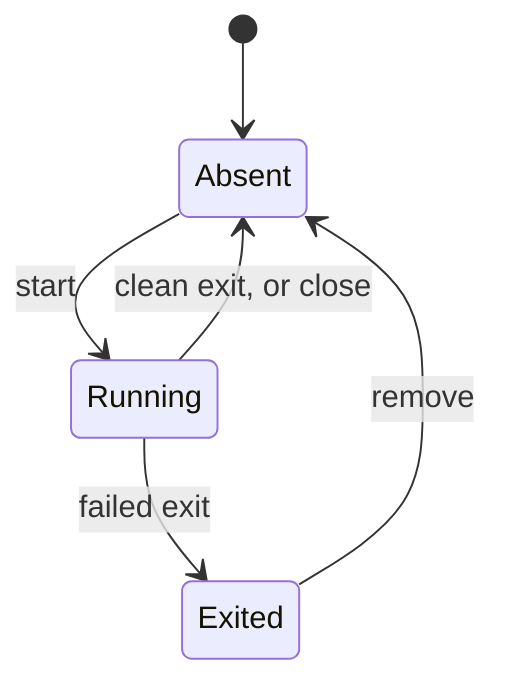

A worker offers its process's stdio in one of two forms, fixed when it starts. Each buffers what the process
writes while nobody reads:

| Form        | How the stdio is reached                                          | Buffered in        |
|-------------|-------------------------------------------------------------------|--------------------|
| Terminal    | joining the tmux session on a tty                                 | tmux's screen      |
| Line stream | writing lines to a FIFO and reading the process's appended logs   | the logs           |

### Agent

An agent is two things under one name: one conversation of an agent program, and the contract that program
offers. A conversation is identified by the program's own session ID. The `agent` package declares the contract
and `claude` implements it for Claude Code.

| State   | Meaning                                                                                                                  |
|---------|--------------------------------------------------------------------------------------------------------------------------|
| Running | The agent program lists the conversation as running: it works on the last message or waits for the next one.             |
| Stopped | The conversation was ended: it was asked to end, or the program exited. Its transcript stays and can be resumed.         |

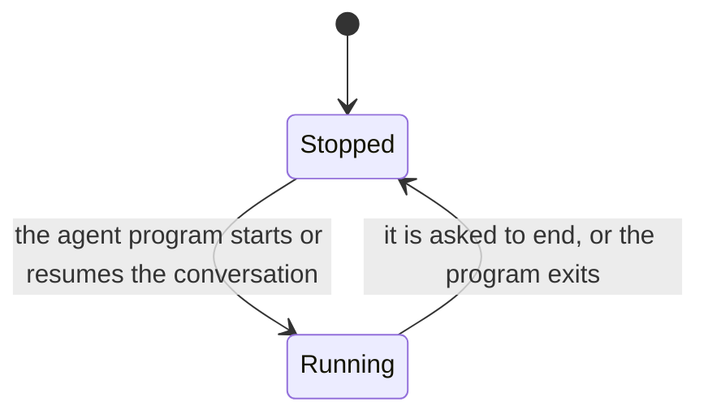

A conversation's state does not depend on whether anyone reads its output. A Running conversation with no reader
stays Running and waits.

The contract is values only, and an agent performs nothing. Asked about a conversation, it answers with:

- the command that runs the conversation, with its paths mapped to the remote;
- what that command requires: the files it must find, the variables it must be given, the directories that must
  be the same on both workstations, and the port its hooks call back on;
- the command that asks the agent program for the conversation's state, and how to read the answer;
- the answer to a client's connection start: the protocol version and the program's capabilities;
- the commands that ask the agent program for the conversations of a directory and for where one conversation
  belongs and its state, and how to read the answers.

An agent is handed a path map and never learns where the other workstation is or how it is reached.

### Workstation

A workstation is a machine with a shell: the **local** one, where the client and Hermod run, and the **remote**,
where the work runs. Hermod reaches workstations by running commands there using `shell`.

| Workstation | What is there                                                                                         |
|-------------|-------------------------------------------------------------------------------------------------------|
| Local       | the client, the Hermod process, the Mutagen daemon, the lock files, the listener of every Net relay   |
| Remote      | the project's directories, the tmux server, the agent program and its adapter, each process's logs    |

Hermod runs no process of its own on the remote: everything there is tmux, the agent program or a
[script](#remote-scripts) a process was started with.

## Storage

Every state has one store and is read from there every time it is needed. Hermod keeps no second copy, so there
is nothing to drift.

| State                                                   | Stored in                                                                     | Read with                                            | Read by                                                          |
|---------------------------------------------------------|-------------------------------------------------------------------------------|------------------------------------------------------|------------------------------------------------------------------|
| Which FS relays exist, their ends and whether they sync | Mutagen                                                                       | `mutagen sync list`, by label                        | **Relay**, asked by **Workspace**                                |
| Which workers exist, their state and workspace          | tmux on the remote                                                            | `tmux ls`, by tag                                    | **Worker**, asked by **Workspace**                               |
| Which conversations exist, their directories, and whether they run | the agent program                                    | the transcripts for which exist and where; `claude agents --json` for which run | **Session**, with the commands and the readings **Agent** declares |
| A relay's connect leases                                | the kernel, as locks on the relay's lock file on the local workstation        | trying to take the lock exclusively, without waiting | **Relay**                                                        |
| What a Disconnected IO relay buffers                    | tmux's screen, or the logs in the worker's directory on the remote            | joining the tmux session, or reading the logs        | **Relay**                                                        |

Two of these stores are files Hermod writes itself:

| File                  | Where                                   | Holds                                                                                        |
|-----------------------|-----------------------------------------|----------------------------------------------------------------------------------------------|
| A lock file per relay | local, `$XDG_RUNTIME_DIR/hermod/lease/` | Nothing: the state is the lock on it, which the kernel holds. The file itself may be left.   |
| A worker's directory  | remote                                  | A line stream's FIFO and logs, and the files the process was started with (its settings).    |

## Packages

| Package     | Represents                                           | Constraints                                                                                                                                                                                                      | Declares                                                                     |
|-------------|------------------------------------------------------|------------------------------------------------------------------------------------------------------------------------------------------------------------------------------------------------------------------|------------------------------------------------------------------------------|
| `cli`       | the process's interface | The only package that reads the arguments, the environment and the process's streams, and the one place every variable Hermod reads is named. Builds everything a command needs from the other adapters and hands it into the core: the agent implementation, the shells, the developer's git facts, the ACP connection and Air's own messages. Decides nothing from a state. | the commands |
| `session`   | [Session](#session) | The only package that decides from states: what to do for a pair of agent and worker states, and where a chat's message goes. Reaches relays and workers only through `workspace`, and an agent only through `agent.Agent`. Declares the messages it routes by what they mean to it (start the connection, list the chats, cancel a request, open, suspend or close a chat, a remote's question and the client's answer, or pass through) and the channel they arrive on, and never a wire format or a client's own method names. Keeps nothing past the process. | `Attach`, `Chat`, `ExitStatus`, `Channel`, `Message`, `Kind` |
| `workspace` | [Workspace](#workspace) | The only package that imports both `relay` and `worker`, and the one that names and tags them. Its state is computed on every call. | `Workspace`, `State`, `Members` |
| `relay`     | [Relay](#relay), [Leases](#leases) | The only package that takes a lock. FS runs the `mutagen` command; Net runs `ssh -R` and a listener in this process; IO copies between local streams and a remote stdio it is handed. | `Relay`, `State`, `Lease`, `Filter`, `Ends`; a constructor for each kind |
| `worker`    | [Worker](#worker)                                    | Mechanism only: builds tmux commands and runs them through a `shell` on the remote. Does not know what its process is. Holds the [scripts](#remote-scripts) a worker starts with.                                 | `Worker`, `State`, `Spec`, `Form`, `Stdio`, `List`                           |
| `agent`     | [Agent](#agent), the contract                        | An interface and values. No behaviour, and no dependency but the shared packages.                                                                                                                                | `Agent`, `State`, `Call`, `Probe`, `Needs`, `Handshake`, `Listing`, `Lookup`, `Conversation` |
| `claude`    | [Agent](#agent), for Claude Code | Pure functions: runs no command and reads no file. The only package that knows Claude Code's arguments, files and ACP adapter program. | `Agent` (implements `agent.Agent`) |
| `acp`       | the ACP wire format | Reads and writes one message per line, and turns each into the `session.Message` it is routed by: the standard methods by itself, a client's own methods by the table it is given. Writes the answers `session` gives in ACP's terms. Routes nothing itself. | `Conn` (implements `session.Channel`) |
| `air`       | JetBrains Air's own facts | The only package that knows the `acp.json` document, the stand-in link and Air's own ACP messages. Says what each of those messages means as a `session.Kind`. Writing `acp.json` keeps every entry and key it does not own. | `Configure`, `Config`, `Entry`, `Methods` |
| `git`       | the developer's git facts | Read-only `git` commands on the local workstation. Called by `cli`, which passes the results on as values. | `Identity`, `Read`, `MainWorktree` |
| `shell`     | [Workstation](#workstation)                          | The only package that starts a process. Each wrapper rewrites the command and hands it inward, and dry-run is chosen once at the innermost one.                                                                  | `Executor`, `Command`, `Execution`; a constructor for each implementation |
| `pathmap`   | the map between local and remote paths               | Pure. Applies to a string or a JSON value, longest root first.                                                                                                                                                   | `Map`, `Place`                                                               |
| `env`       | variables as pairs                                   | The one place that splits and joins `KEY=VALUE`.                                                                                                                                                                 | `Vars`                                                                       |
| `secret`    | a value that must not be printed                     | A token prints as a mask everywhere but where it is delivered.                                                                                                                                                   | `Token`                                                                      |

### Package dependencies

Diagram below shows direct package imports. An **Adapter** imports the **Core** and the **Core** imports no **Adapter**; inside the **Core**, a
package imports only its own layer or a lower one.  The **domain** layer holds the key components. The **application**
layer drives them for one command, and the **foundation** layer is what they are built on.


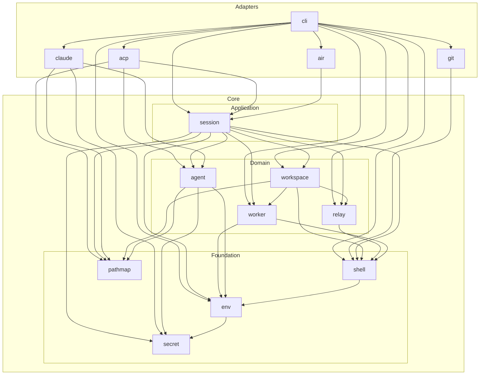

### Remote scripts

A worker starts through a shell script on the remote: one that keeps a failed process's pane, and one that gives
a line stream its FIFO and logs. Each script is a file embedded in the `worker` package and is sent to the
remote's `sh` on its standard input when it is run, so nothing of Hermod's is installed there. A script takes its
inputs as arguments and environment, and nothing is substituted into its text: it reads the same in the
repository as on the remote.

## Interfaces

A package gets an interface for one of four reasons, and only for them. Everything else is a concrete type,
tested through a fake `shell.Executor`.

- **Kinds:** one component has several implementations behind one set of operations.
- **Inversion:** the core needs something an adapter provides, and the core imports no adapter. The core
  declares the interface and the adapter implements it.
- **Looking up:** a component needs an answer from above it, and may not know who answers. It declares the
  question as an interface and is handed the answer.
- **Narrowing:** a callee is handed only the operations it may use of a value its caller holds.

| Interface          | Declared in | Implemented by                                    | Reason     | Handed in by |
|--------------------|-------------|---------------------------------------------------|------------|--------------|
| `shell.Executor`   | foundation  | `shell`: local, dry-run, ssh, login, tmux         | kinds      | `cli`        |
| `relay.Relay`      | domain      | `relay`: fs, io, net                              | kinds      | —            |
| `relay.Lease`      | domain      | `relay`, one for each kind of relay               | kinds      | —            |
| `relay.Filter`     | domain      | `session`, from what an agent declares            | looking up | `session`    |
| `agent.Agent`      | domain      | `claude`                                          | inversion  | `cli`        |
| `session.Channel`  | application | `acp`                                             | inversion  | `cli`        |
| `session.Receiver` | application | `acp`, as half of a `Channel`                     | inversion  | `cli`        |
| `session.Sender`   | application | `acp`, as half of a `Channel`; a function; a conversion in front of another `Sender` | kinds      | `session`    |
| `session.Message`  | application | `acp`                                             | inversion  | —            |
| `session.PathMap`  | application | `pathmap.Map`, through a conversion between `Path` and a string | inversion | `cli`, in what `attach` returns; `workspace.Map`, for the remote's whole map |
| `session.StateMachine[S]` | application | `session`: `StateMachineImpl`, the machine of a session and of a chat; a state may only switch it | narrowing | `session` |
| `session.SessionState` | application | `session`: attached, detached                | kinds      | —            |
| `session.ChatState` | application | `session`: unopened, opening, open, suspended, closed | kinds | —            |

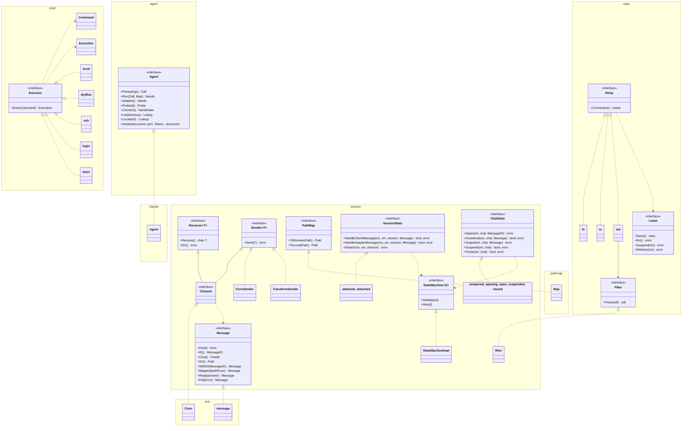

### `shell.Executor` — a workstation

One method: execute one `Command` and return its `Execution`. A `Command` is built once and carries the
arguments, the directory, the variables and the streams. An `Execution` gives the running command's streams and
its result.

| Implementation | What it is                                                                |
|----------------|---------------------------------------------------------------------------|
| local          | Runs the command on this machine.                                         |
| dry-run        | Prints the command as a line that can be pasted, and runs nothing.        |
| ssh            | Wraps an inner `Executor`: the command runs on a host.                    |
| login          | Wraps an inner `Executor`: the command runs under the user's login shell. |
| tmux           | Wraps an inner `Executor`: the command runs in a tmux session.            |

The first two say **how** a command runs and the other three **where**. A caller nests the ones it needs, and the
choice between local and dry-run is made once, at the innermost one, so nothing above it knows about dry-run.
Commands that only read a state always run on a local one.

### `relay.Relay` and `relay.Lease` — one channel, and a claim on it

A `Relay` has one method. `Connect` takes a connect lease, makes the relay if it is Absent, takes it to
Connected, and starts whatever serves it in this process: nothing for an FS relay, the copying for an IO relay,
the listener for a Net relay. It returns the `Lease`.

| `Lease` method | What it does                                                                                                         |
|----------------|----------------------------------------------------------------------------------------------------------------------|
| `Done`         | A Go channel, closed when the relay stops serving on its own: an IO relay whose local side left or whose process ended, a Net relay whose connection dropped. |
| `Err`          | Why, once `Done` is closed.                                                                                           |
| `Suspend`      | Gives the lease up. When it was the last, the relay is left Disconnected, or removed for a Net relay ([Leases](#leases)). |
| `Release`      | Gives the lease up. When it was the last, the relay is removed; an FS relay is flushed first.                         |

There is no operation to disconnect or remove a relay directly: a relay changes state only when its last lease is
given up, as [Leases](#leases) describes.

| Implementation | Constructed from                                                   | Adds                                                                                   |
|----------------|--------------------------------------------------------------------|----------------------------------------------------------------------------------------|
| fs             | `Ends` (a local root and a remote root), a name, labels            | `Flush`; `List`, which reads the relays under a label with their ends and states       |
| io             | a remote stdio (a command that reaches it), local streams          | —                                                                                      |
| net            | a remote port, a local address, an optional `Filter`               | —                                                                                      |

Reading a relay's state can fail. That is an error, not a fourth state.

### `relay.Filter` — what a Net relay lets through

One method: given a call that arrived on the remote port, return the call to make locally, or refuse it.
`session` implements it for an agent's hooks, from the token and the address the agent declared
([Hooks](#hooks)). A user's own Net relay has none.

### `agent.Agent` — an agent program's contract

Every method is a question answered with a value; an agent performs nothing.

| Method    | The question                                 | The answer                                                                                                                                             |
|-----------|----------------------------------------------|--------------------------------------------------------------------------------------------------------------------------------------------------------|
| `Parse`   | What do these arguments ask for?             | a `Call`: a conversation and its ID, or a one-shot call                                                                                                |
| `Run`     | What does running this call need?            | a `Needs`: the command with paths mapped, the files it must find, the names of the variables it must be given, the directories and the port it requires |
| `Adapter` | What does the program's ACP adapter need?    | a `Needs` of the same shape                                                                                                                            |
| `Probe`   | Is this conversation running?                | a `Probe`: the command that asks the agent program, and how to read its output into a `State`                                                          |
| `Connect` | How is a client's connection start answered? | a `Handshake`: the protocol version and the program's capabilities                                                                                     |
| `List`    | Which conversations do this directory and the directories under it have? | a `Listing`: the command that asks the agent program, and how to read its output into `Conversation`s: each one's ID, directory, `State`, title and last update |
| `Locate`  | Where does this conversation belong?         | a `Lookup`: the command that asks the agent program, and how to read its output into the `Conversation`, or into none when the program does not have it |
| `Hooks`   | How do the program's hooks call back?        | the settings document with its hooks aimed at a port and carrying a token                                                                              |

### `session.Channel` and `session.Message` — a chat client's connection

`session` routes a chat's messages without knowing how they are written. A `Channel` is one side's connection,
made of two halves:

| Interface     | Method    | What it does                                                                         |
|---------------|-----------|--------------------------------------------------------------------------------------|
| `Receiver[T]` | `Receive` | A Go channel of the messages that arrive. It is closed when the connection ends.      |
|               | `Err`     | Why the connection ended, once `Receive` is closed.                                   |
| `Sender[T]`   | `Send`    | Sends one message, or says why it could not.                                          |

Incoming messages arrive on a Go channel so that one loop can wait on the client and on every adapter at once.
Sending stays a call because it can fail. A `Channel` is a `Receiver[Message]` and a `Sender[Message]`;
`FuncSender` makes a `Sender` of a function, which is how a chat is handed its way to the client, and
`TransformSender` is a `Sender[A]` that converts each message with a function and sends it on to a `Sender[B]`.

A `Message` says what `session` needs to route it:

| Method   | What it gives                                                    |
|----------|------------------------------------------------------------------|
| `Kind`   | What the message means to a session, from the table below        |
| `ID`     | The request this message is, answers, or cancels                 |
| `Chat`   | The chat it belongs to, if any                                   |
| `Dir`    | The directory it names, if any                                   |
| `WithID` | The same message under another request ID                        |
| `Mapped` | The same message with every path in it taken through a function  |
| `Reply`  | The answer to a request `session` answers itself: empty, an `agent.Handshake`, or the `agent.Conversation`s of a list |
| `Fail`   | An error answer to this request                                  |

| Kind       | Meaning                                                                                            |
|------------|----------------------------------------------------------------------------------------------------|
| `Pass`     | Nothing to decide: the message goes to the other side.                                             |
| `Connect`  | The client starts its connection. `session` answers it from the agent and keeps it for every adapter. |
| `List`     | The client asks for the chats of a directory. `session` answers it from the agent program.         |
| `Cancel`   | The client cancels one of its requests, the one `ID` gives.                                        |
| `Open`     | The client opens a chat in a directory, or returns to one.                                         |
| `Suspend`  | The client stops showing a chat, which keeps running. `session` answers it and never passes it on. |
| `Close`    | The client ends a chat: its agent stops.                                                           |
| `Question` | A remote asks the client and expects an answer.                                                    |
| `Answer`   | The client answers a remote's question.                                                            |

`acp.Conn` implements `Channel` over a pair of streams, one message per line. It gives a message its `Kind`
itself where ACP's shape and standard methods say it, and a client's own methods by the table it is given, which
`air` provides for Air ([Air's messages](#airs-messages)).

### Concrete types

| Type                  | Operations                                                                                           | Notes                                                                                                                         |
|-----------------------|------------------------------------------------------------------------------------------------------|-------------------------------------------------------------------------------------------------------------------------------|
| `workspace.Workspace` | `Open` (the workspace of a remote and a directory), `Map` (the path map of every workspace on a remote, read from the FS relays Mutagen lists under `hermod-remote`; a directory under none of their roots is mapped as a new workspace would join it, [rule 3](#which-workspace-a-directory-belongs-to), in either direction), `State`, `PathMap`, `AddFS`, `AddNet`, `Start`, `Attach`, `Detach`, `Close` | `Attach` connects its relays, the IO relay to one worker's stdio on the caller's streams among them, and returns when that relay or an FS relay stops serving. `Detach` gives up every lease this process holds ([Detach](#detach)). `Close` ends one worker, or removes it when it is Exited ([Close](#close)). |
| `workspace.Members`   | —                                                                                                    | What a workspace holds, as one read returns it: its FS relays with their ends and states, read from Mutagen, and its workers with their states, read from tmux. `State` is computed from it. |
| `worker.Worker`       | `State`, `Start`, `Close`, `Remove`, `Stdio`; `List` by tag                                          | `Spec` says what to start: key, directory, command, files, variables, tags and the stdio `Form` (terminal or line stream).    |
| `air.Config`          | `Load`, `Merge`, `Save`                                                                              | Merging keeps every entry and key it does not own.                                                                            |
| `pathmap.Map`         | `ToRemote`, `ToLocal`                                                                                | Built from pairs of a local and a remote root, longest root first, on strings. `session` takes it as a `session.PathMap`, through a conversion between `session.Path` and a string; that interface's methods are the functions a `Message` is `Mapped` with. |
| `session.SessionControl` | `HandleClientMessage`, `HandleAdapterMessage`, `Detach`                                          | One session: its machine and its context. The first two report whether the session ended ([Router, sessions and chats](#router-sessions-and-chats)). |
| `session.ChatControl` | `Open`, `Answered`, `Output`, `Suspend`, `Close`                                                     | One chat: its machine and its context, made in Unopened, or in the state its located conversation maps to. `Answered` reports whether the answer opened the chat, and `Suspend` and `Close` whether the client waited on it ([Chat states](#chat-states)). |

## Flows

Each flow shows which package does each step, and states the rules each step follows.

### Session: `hermod attach`, and `claude` on a terminal

Every session, whoever starts it, runs these steps.

1. **Open the workspace.** Find [the workspace the directory belongs to](#which-workspace-a-directory-belongs-to),
   or make it. Connect the FS relay that covers the directory, and flush it. The path map is now fixed for the run.
2. **Read the states.** One call on the remote reads the worker's state and, for a worker that runs one agent,
   whether its conversation runs.
3. **Decide.**

   | Agent   | Worker            | Action |
   |---------|-------------------|--------|
   | Running | Running           | attach |
   | Running | Absent            | refuse: it runs outside Hermod, and a start would be a second copy |
   | Stopped | Running or Exited | remove the worker, then decide as Absent |
   | Stopped | Absent            | start, with the caller's arguments as given |

   A worker that does not run one agent has only the worker column: Absent starts it, Running attaches, and an
   Exited one is removed first. Whether a Stopped conversation can be resumed is not a state Hermod reads: the
   caller's arguments say whether to resume, and the agent program refuses when there is nothing to resume.
4. **Start**, when the table says so. The workspace first adds, connects and flushes the FS relays the agent
   requires, so its transcripts are on the remote before it reads them. Then the
   [worker's directory](#a-workers-directory) is written, and the worker starts in the directory's remote path.
5. **Attach the workspace.** The workspace adds the session's remaining relays, the IO relay to the worker among
   them, and connects them. The client is now connected to the worker.
6. **Detach the workspace.** Stdin EOF, a signal or a dropped connection ends the attach, and the session
   [detaches](#detach) the workspace. The worker keeps running. A process that was ended this way then exits at
   once, so the program that started it never has to kill it.

| Started as | Worker runs | Agent | IO form | Net relays |
|------------|-------------|-------|---------|------------|
| `hermod attach` | the user's command | none | terminal | the user's `-R`, if any |
| `claude ARGS…` on a tty | Claude's command, mapped | Claude | terminal | the hooks, when the settings carry them |

```mermaid
sequenceDiagram
    participant cli
    participant session
    participant agent as agent (claude)
    participant workspace
    participant relay
    participant worker
    cli ->> session: Attach(request)
    opt the command is an agent's
        session ->> agent: Parse(args)
        agent -->> session: Call (a conversation and its key)
    end
    session ->> workspace: Open(remote, directory)
    workspace ->> relay: List the FS relays, then Connect and Flush the one that covers the directory
    workspace -->> session: Workspace, PathMap
    session ->> workspace: State of the worker (key)
    workspace ->> worker: State
    opt the worker runs an agent
        session ->> agent: Probe(key)
        Note over session: runs the probe's command on the remote
    end
    Note over session: decides from the two states
    opt start
        session ->> agent: Run(Call, PathMap)
        agent -->> session: Needs
        session ->> workspace: AddFS for each FS relay the agent requires
        session ->> workspace: Start(Spec)
        workspace ->> worker: Start
    end
    session ->> workspace: AddNet, then Attach(key, streams)
    workspace ->> relay: Connect each relay; the IO relay copies the worker's stdio
    Note over workspace: waits until the IO relay's lease is Done
    session ->> workspace: Detach
    workspace ->> worker: List (does a worker remain?)
    alt a worker remains, or the list cannot be read
        workspace ->> relay: Suspend each lease
    else none
        workspace ->> relay: Release each lease
    end
    session -->> cli: the result
```

### Detach

`Workspace.Detach` gives up every lease the process holds on the workspace's relays, suspending or releasing them
as [Workspace](#workspace) says; it reads the workers from tmux. Every error met on the way is returned together;
the leases are given up all the same.

Relays left Disconnected stay so when their last worker then exits on its own, since only a lease given up settles
a relay ([Leases](#leases)). The next session that attaches the workspace and detaches it finds no worker, and
releases them.

### One-shot call

Arguments that name no conversation (a subcommand such as `auth`, `--version`, `--help`, `-p` without a session)
are not a session. `session` runs the command on the remote with the caller's stdio and exits with its code. It
runs in the project's remote directory when that exists, else in the remote user's home.

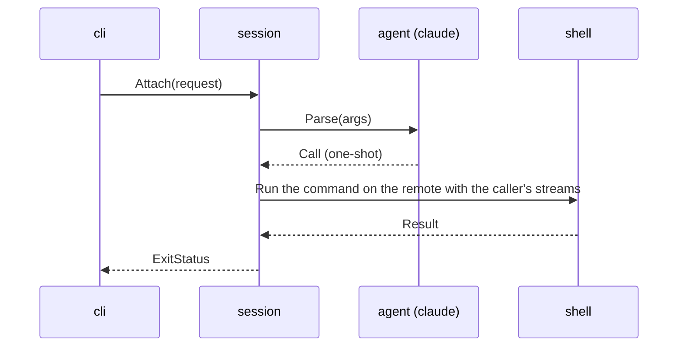

No workspace, no worker and no relay take part.

### Chat: `hermod air acp`

A chat client holds one connection for every chat of every project, while each project's chats run in its
workspace's own adapter, a line-stream worker on the remote. `session.Chat` serves that connection. `cli` builds
it from the client's `Channel` (an `acp.Conn` over stdin and stdout, with Air's table), the agent, the remote (its
shell and its name) and an `attach` function, which attaches the workspace a directory belongs to, starting its
adapter when none runs, and returns the workspace, its root, its path map, the adapter's `Channel` and whether it
started the adapter.

A chat's agent runs inside the adapter, which starts, resumes and ends it. `session` asks the agent program only
where a chat it does not hold belongs, which chats a directory has, and whether any of them still runs.

#### Router, sessions and chats

Three levels nest, and each owns its own state:

| Level   | Is                                                 | Decides                                                       |
|---------|----------------------------------------------------|---------------------------------------------------------------|
| router  | `Chat`: the one client connection                  | which session a message is for, and when a session is made or forgotten |
| session | one workspace held attached: its adapter and chats | whether the workspace stays attached, and what it registers about its chats and requests |
| chat    | one conversation                                   | whether the client shows it, and what of its output reaches the client |

The router knows nothing about a chat, and a chat knows nothing about relays. Each level hands an event down: it
calls a method on the `SessionControl` or `ChatControl` ([Concrete types](#concrete-types)) of the level below and
reads the outcome from what the method returns. Nothing calls upwards, and nothing asks a state what it holds.

A session and a chat are state machines in the state pattern. A state is a type, and an event is a method of
it. With every event a state is handed its machine (a `StateMachine[S]` with `SetState`, and `Abort`, which marks
the machine aborted and which no state calls) and a context struct that holds the level's data, and decides
itself whether to switch and to which state. An event that sets nothing leaves the machine where it was. A `SessionControl` or a `ChatControl`
holds the machine and the context, and is what the level above calls. A rule then lives in the one state it
applies to, and a client request that a state does not allow is an error rather than a silent no-op.

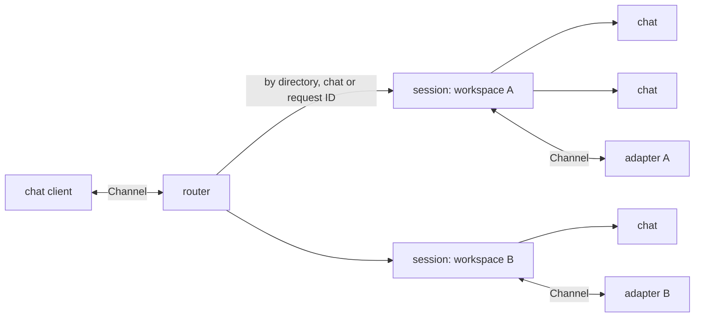

#### Shared maps

The levels share plain maps, each written in one place:

| Map        | From → to                                    | Held by                         | Written by                                                                                           |
|------------|----------------------------------------------|---------------------------------|------------------------------------------------------------------------------------------------------|
| sessions   | directory → session, keyed by the exact directory its first `Open` names or its first located chat's directory, mapped to local | the router | the router: added on an `Open` in a directory no session holds or for a located chat whose directory no session holds, removed when an event reports the session ended |
| owners     | chat ID → directory of its session           | the router, shared with every session | a session: added when the adapter's answer names an opened chat or the chat is located, removed when the chat is closed or the session detaches |
| chats      | chat ID → chat                               | each session                    | the session, from the same events as owners                                                          |
| opening    | the client's request ID → chat               | each session                    | the session: added on an `Open`, removed when the adapter answers it                                 |
| closing    | the client's request ID of the `Close` that left no chat waited on | each session | the session: set on that `Close`, cleared when the adapter answers it (an adapter message that is not a `Question`) |
| requests   | `hermod-<n>` → asking session and the adapter's own ID | the router, shared with every session | a session adds one for each `Question` it sends; the router removes it on the `Answer`; a session that detaches drops its own |
| pending    | the client's request ID → directory of the session it went to | the router | the router: added when it passes a client request to a session, removed when that session's adapter answers it (an adapter message that is not a `Question`) or the session is forgotten |

A chat is found in two ways because a message names it in two ways: by the chat's ID, and, while it is being
opened, by the client's request that opens it. A new chat has no ID until the adapter answers that request.

The router routes a client message by its kind: `Connect` and `List` it answers itself
([The client's connection](#the-clients-connection)); an `Open` by the owner of the chat it names, else by its
directory, attaching a new session when none holds it; an `Answer` by the request it answers; a `Cancel` by the
pending request it cancels; every other message by the owner of its chat. A chat that no session holds is
[located](#events) in the agent program. An `Open` in another directory of a
workspace that a session already holds, such as a subdirectory, makes a second session, whose attach asks for the
same adapter's line stream and is refused ([How relays enter a workspace](#how-relays-enter-a-workspace)). A
message from an adapter carries the directory of the session it came from. A forwarder per adapter carries the adapter's messages
into the router's one loop, and then the news that the adapter's connection ended.

#### Session states

| State    | Meaning                                                                                                   |
|----------|-----------------------------------------------------------------------------------------------------------|
| Attached | The workspace's relays are leased and messages flow. It counts the chats the client waits on.             |
| Detached | The leases are given up. The session takes nothing more; a client that returns gets a new one.            |

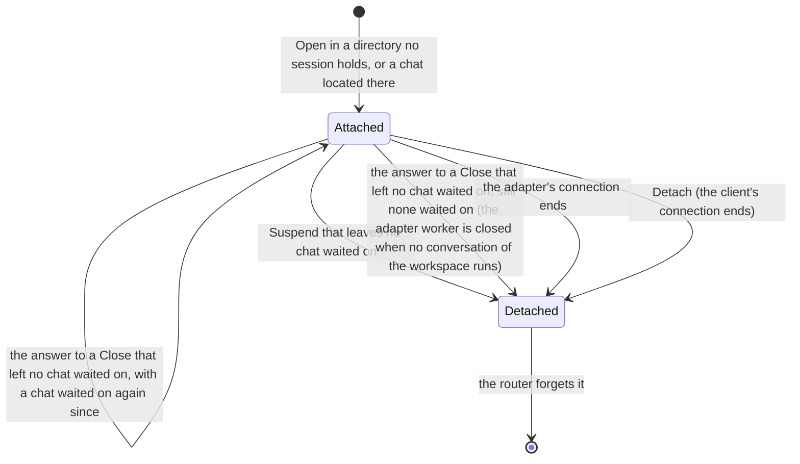

A session detaches its workspace first and switches to Detached only when that succeeded: one whose workspace
could not be detached still holds it, and the error ends `Chat`. After a Close that left no chat waited on, the
session records its ID and waits for the adapter's answer to it, so the adapter has ended the chat. At that answer
it checks again: an `Open` that came meanwhile has it waiting on a chat, and it stays Attached. Still waiting on
none, it runs the agent's `List` for its workspace's root, mapped to the remote: the adapter runs every
conversation of the workspace, a subdirectory's included, and the listing covers the directories under the root.
With no conversation running, it closes the adapter worker instead of detaching:
`Workspace.Close` ends the worker and, with no other worker left, releases the relays ([Close](#close)). With one
running, the adapter runs on and the session detaches, the leases suspended. What the session put into the shared maps
leaves with it, and so do its chats, the questions they hold included. In Detached a client message is an error,
and an adapter message is one that was on its way when the session ended, and is dropped.

Detached is the end of a session that the router is about to forget: it holds no lease and takes no message. So
while a session exists in the sense of [Session](#session) it is Attached, and the machine's two states cover only
the step in which the router drops it.

#### Chat states

| State     | The client waits on it | The adapter's output for the chat                                                                    |
|-----------|------------------------|------------------------------------------------------------------------------------------------------|
| Unopened  | no                     | dropped                                                                                              |
| Opening   | yes                    | sent to the client                                                                                   |
| Open      | yes                    | sent to the client                                                                                   |
| Suspended | no                     | a `Question` is held while the session stays attached, since nobody can answer it now and a request is not replayed; anything else is dropped, and the adapter replays it when the chat is opened again |
| Closed    | no                     | never handed any: a closed chat leaves the session's chats, so its output goes to the client as a message of no chat |

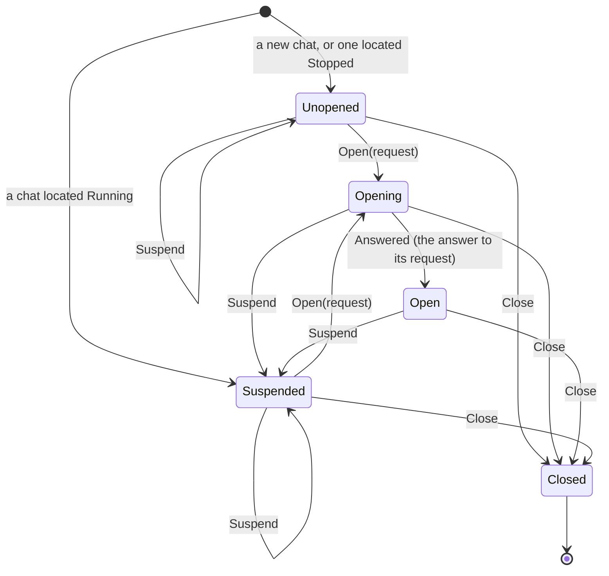

A chat that no session holds is located in the agent program ([Events](#events)) and enters the state its
conversation's state maps to: Suspended when it is Running, since its agent runs and nobody shows it, and Unopened when
it is Stopped.

- **Opening ends with the answer.** When the adapter answers the request that opened the chat, the chat sends the
  client that answer first and then the questions it held, takes the chat ID the answer names, and is Open.
  `Answered` reports whether the answer was the one the chat waited for; an answer to another request is not this
  chat's and changes nothing. In Suspended `Answered` reports false.
- **Opening → Suspended is reached only for a chat the session already holds**: a new chat has no ID the client
  could name until the answer to its `Open`, which takes it to Open.
- **`Suspend` and `Close` report whether the client waited on the chat**, so the session knows whether it waits on
  one chat fewer.
- **Any other event is refused**: it is an error, which ends `Chat`; the chat's state is not changed.

#### Request IDs

Each adapter numbers its own requests from one counter across its chats, and Air answers under the same ID
([Session lifecycle](air-integration.md#session-lifecycle)). Two adapters therefore send the same IDs over the
client's one connection. So every `Question` gets an ID of the router's own, `hermod-<n>`, on its way to the
client, and the requests map records which session asked and under which ID of the adapter's. The `Answer` is
routed by that ID to the session that asked, and passed to its adapter under the adapter's own ID.

The client's requests keep their IDs: the client numbers them in one sequence across all its projects, so each
adapter receives IDs that are unique.

#### Events

| Event | What happens |
|-------|--------------|
| `Connect` from the client | The router answers it with the message's `Reply` and the agent's `Handshake`, and keeps the message without the `fs` and `terminal` client capabilities ([The client's connection](#the-clients-connection)). |
| `List` from the client | The router maps the directory to the remote by the remote's path map (`workspace.Map`), runs the agent's `List` for it on the remote, and answers with the conversations of that directory, leaving out
those of the directories under it, their directories mapped back; a directory no relay covers is mapped as a new workspace would join it, so a project never attached here gets the remote's list too, often empty. A command or a reading that fails is answered with `Fail`. |
| `Cancel` from the client | Routed by the pending request it cancels to that session, and passed to its adapter. A `Cancel` of a request no session holds is dropped. |
| `Open` | The router finds the session by the owner of the chat the message names, or for a new chat by the directory, attaching a new session when none holds the directory and starting its forwarder; a workspace that cannot be attached ends `Chat` with that error. The session takes the chat it knows by that ID, or a new one, opens it and records it under the request; it waits on one chat more. The message goes to the adapter. |
| The adapter answers an `Open` | Only an adapter message that is not a `Question` is matched against the opening map: the adapter numbers its own requests apart from the client's ([Request IDs](#request-ids)), so a question can carry the ID of an `Open` still waiting. The chat is Open; the session records it under the ID the answer names, in its chats and in the owners. When the chat was suspended meanwhile, the answer is dropped and the chat stays Suspended. |
| `Suspend` | The chat is Suspended, or stays Unopened when it was never opened. The session answers the client with the message's `Reply` and passes nothing on: an adapter that received it would end the chat. When the client waited on it, the session waits on one chat fewer. Waiting on none, it detaches. |
| `Close` | The chat is Closed and leaves the chats and the owners. The message goes to the adapter, which ends the chat; what the adapter still sends of that chat goes to the client as a message of no chat. When the client waited on it, the session waits on one chat fewer. Waiting on none, it records the `Close`'s ID and ends at the adapter's answer, unless a chat is waited on again by then: it closes the adapter worker when no conversation of its workspace runs, and detaches otherwise ([Session states](#session-states)). |
| The adapter answers the kept `Connect` | Matched by the `Connect`'s ID, which the session records when it sends it, first of all, to an adapter that `attach` reports it started; a difference from the agent's `Handshake` in protocol version or capabilities is logged, and the answer is dropped. |
| `Question` from an adapter | Renumbered on its way to the client; held while its chat is Suspended. |
| `Answer` from the client | Routed by its ID to the session that asked, and passed on under the adapter's own ID. |
| A `Pass` | Goes to the other side: to the adapter of the chat's session, or, from an adapter, to the chat, or straight to the client when it names no chat the session holds. |
| A `Suspend`, a `Close`, or an `Open` that names a chat, for a chat that no session holds | The router runs the agent's `Locate` for the chat on the remote. With the conversation found, it maps its directory to the local one by the remote's path map, finds or attaches the session for that directory as for an `Open`, and the session takes the chat in the state the conversation's state maps to ([Chat states](#chat-states)) and records it in its chats and the owners; then the event is handed on as for a chat the session holds. A chat the agent program does not have, or a lookup that fails, is answered with the message's `Fail`, and `Chat` goes on. A located chat whose directory is another directory of a workspace that a session already holds, such as a subdirectory, makes a second session as an `Open` there does, and its refused attach ends `Chat`. |
| A `Pass` from the client for a chat that no session holds, or that names no chat | Answered with the message's `Fail` when it is a request, and dropped otherwise; `Chat` goes on. |
| The adapter's connection ends | The session detaches and is forgotten; the adapter's chats go with it. |
| The client's connection ends, or `Chat`'s context | The router detaches every session it holds, stops the forwarders and returns. The workers keep running. |
| Any error a session or chat returns, an answer to an unknown request, or a failed send | `Chat` returns that error, after detaching every session it holds. |

Every message to an adapter is `Mapped` to the remote's paths, and every message to the client to the local ones,
by the session's path map.

An adapter ends its chats when its connection ends. A worker's stdin is a FIFO that stays open with no client
([Line streams](#line-streams)), so to an adapter its connection never ends: a chat that nobody shows runs on, and a new `hermod air acp` attaches to the same adapter.

What the adapter writes while its workspace is detached waits in the line stream's logs, and is delivered when the
next session attaches, before that session's `Open` reaches the adapter. A session attached for an `Open` holds no
chat yet, so this output goes straight to the client, a held question included, ahead of the answer to the `Open`.
One attached for a located chat holds that chat before the output is handled, since the forwarder feeds the
router's one loop, so the output of that chat is handled as for its state, a question held in Suspended.

#### Air's messages

| Air's message                                   | Kind       | Given by |
|-------------------------------------------------|------------|----------|
| `session/new`, `session/load`, `session/resume` | `Open`     | `acp`    |
| `session/close`, sent on every closed tab and at an IDE quit | `Suspend` | `air` |
| `_session/archive`, "mark done"                 | `Close`    | `air`    |
| `_session/unarchive`, sent before reopening a chat marked done | `Pass` | `acp` |
| `initialize`                                    | `Connect`  | `acp`    |
| `session/list`                                  | `List`     | `acp`    |
| `$/cancel_request`                              | `Cancel`   | `acp`    |
| a request from the adapter, such as `session/request_permission` | `Question` | `acp` |
| the client's answer to it                       | `Answer`   | `acp`    |
| anything else                                   | `Pass`     | `acp`    |

#### The client's connection

`session` answers what names no chat itself, from the agent. It answers the client's `Connect` with the agent's
`Handshake`, and keeps the `Connect` without the `fs` and `terminal` client capabilities, so the agent acts on the
remote only. Every adapter that `attach` reports it started is sent the kept `Connect` before anything else, and the session
records its ID and drops the adapter's answer to it, logging where it differs from the `Handshake`; an adapter that already runs has had it, and ACP allows it only as a
connection's first request. The chats of a directory, and where a chat belongs, are the agent program's to say
([Storage](#storage)): `session` runs the agent's `List` and `Locate` on the remote and stores nothing of a chat.

```mermaid
sequenceDiagram
    participant Air
    participant cli
    participant session
    participant agent as agent (claude)
    participant workspace
    participant adapter as adapters on the remote
    Air ->> cli: starts hermod air acp
    cli ->> session: Chat(client, agent, remote, attach)
    Air ->> session: initialize (Connect)
    session ->> agent: Connect()
    session -->> Air: the Handshake; the Connect is kept without fs and terminal
    Air ->> session: session/list (List, a directory)
    session ->> agent: List(the directory, mapped to the remote)
    Note over session: runs the listing's command on the remote
    session -->> Air: the conversations, paths mapped back
    Air ->> session: session/new (Open, a directory)
    session ->> workspace: attach: Open(remote, directory), State of the adapter worker
    opt Absent
        session ->> agent: Adapter()
        session ->> workspace: Start(Spec for the adapter), AddNet for its hooks
        session ->> adapter: the kept Connect; its answer is dropped
    end
    session ->> workspace: Attach(adapter, a line stream)
    session ->> adapter: session/new, paths mapped to the remote
    adapter -->> session: answer and updates
    session -->> Air: the same, paths mapped back, questions renumbered
    Air ->> session: session/close (Suspend)
    session -->> Air: the reply; nothing is passed on
    opt it was the last chat the session waited on
        session ->> workspace: Detach
    end
    Air ->> session: _session/archive (Close)
    opt no session holds the chat
        session ->> agent: Locate(chat)
        Note over session: runs the lookup's command on the remote
        session ->> workspace: attach the directory it reports
    end
    session ->> adapter: the archive: the adapter ends the chat
    adapter -->> session: the answer
    opt the session waits on no chat
        session ->> agent: List(its workspace's root, mapped to the remote)
        alt no conversation of the workspace runs
            session ->> workspace: Close(adapter worker)
        else one runs
            session ->> workspace: Detach
        end
    end
    Air ->> session: stdin EOF or SIGTERM
    session ->> workspace: Detach, for every session it holds
```

### Close

Closing a worker ends its process with SIGHUP, so an agent saves its transcript. The workspace connects its
relays first, so the decision cannot race another session, then closes the worker and [detaches](#detach): with
another worker left the relays stay, and with none they go. The worker's directory stays. An Exited worker is
removed instead, in the same steps. A worker that is already Absent has nothing to close, and its relays are left
as the last detach decided.

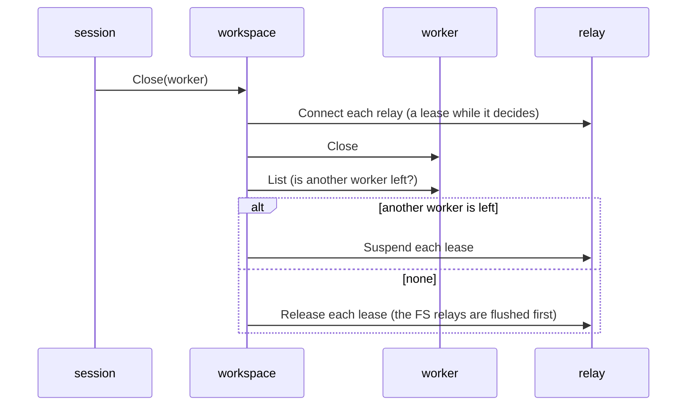

### Registration: `hermod air configure`

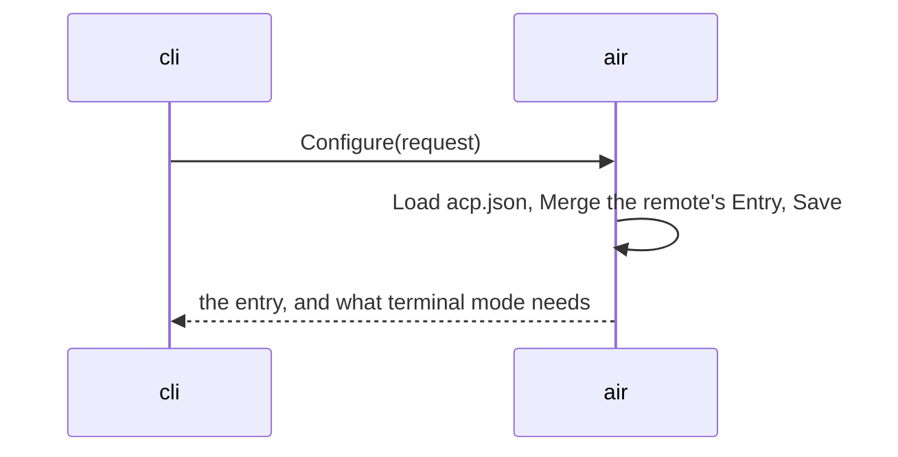

## Mechanisms

### Which workspace a directory belongs to

It is decided once, when a session starts:

1. the workspace whose project FS relay covers the directory;
2. else, for a linked git worktree, the workspace that covers its main working tree, where the worktree gets an FS
   relay of its own;
3. else a new workspace, whose project FS relay joins the directory to the corresponding remote path. A root that
   holds existing roots gets one too, with a warning: the inner workspaces stay, so their files are carried twice.

### How relays enter a workspace

A relay is its two ends, so the same two ends are never joined twice: a session or a worker that needs a relay
already there leases it. A relay belongs to the workspace that made it; a workspace that needs two ends another
one already joined leases that relay instead of making a second.

| Relay | Added for | Shared by the workspace's sessions |
|-------|-----------|------------------------------------|
| FS, the project | the workspace itself | yes |
| FS, another directory | a session whose directory lies outside the project relay, or an agent that declares one (its transcripts) | yes, by every session that needs the same two ends |
| Net | an agent that declares one (its hooks), or the user's `-R` | no: its local end is a listener inside one session's process |
| IO | each worker | no: one per worker |

- **The path map.** An FS relay is configured with its two ends, a (local root, remote root) pair. The pairs of a
  workspace's FS relays, longest root first, are the path map. A path is mapped by the root that is its longest
  prefix at a path-segment boundary, and a path under no root is left as it is. The map applies to a string and to
  every string in a JSON value. Paths cross between the workstations in four places: a worker's arguments, ACP
  messages, hook bodies and the files themselves; the first three are mapped by the one map the fourth defines.
- **An FS relay never picks a winner.** Every FS relay is Mutagen's `two-way-safe`: edits made on either side
  reach the other, and a file changed on both sides is left as it is on each and reported as a conflict until the
  developer settles it. The developer has to see what the remote changed, and to bring local changes to the
  remote, and neither may be discarded.
- **Mutagen is the registry of FS relays.** Which local roots are on a remote, and where, are the ends of the FS
  relays Mutagen lists under the workspace's label. Paths stay in the ends because a label value cannot hold one.
- **One reader for a line stream.** A second session that asks for a line-stream IO relay while it is leased is
  refused.
- **No shared ssh master.** The ssh connections that carry relays refuse a shared master connection, which
  silently drops new `-R` forwards.

### Names and tags

Everything a session uses is found from its workspace or from the `hermod` prefix, with the tool that owns it.
`workspace` derives the names and the labels; `relay` and `worker` are given them.

| Thing | Name | Tags | Read with |
|---|---|---|---|
| Workspace | the name of its project FS relay | — | the two rows below |
| Worker (remote) | tmux session `hermod-<key>`, or `hermod-acp-<workspace>` for an adapter; a plain `attach` keeps its name | options `@hermod-workspace`, `@hermod-origin` | `tmux ls -F '#{session_name} #{@hermod-workspace} #{@hermod-origin}'` |
| Worker's directory (remote) | `~/.hermod/s/<tmux session>/` | — | — |
| FS relay (local) | `hermod-<remote>-<slug>-<local>`: `<remote>` the alias reduced to the letters, digits and dashes Mutagen accepts, `<slug>` from its remote end, `<local>` a hash of its local end | labels `hermod-remote=<remote>`, `hermod-workspace=<workspace>` | `mutagen sync list --label-selector hermod-workspace=<workspace>` |
| Log (local) | `~/.cache/hermod/air/<key>.log` | — | — |

- **`@hermod-workspace`** is the workspace a worker belongs to. A workspace reads its workers by it, so no file on
  either workstation records it. `hermod-remote` lists every workspace on a remote, and the ends of the FS relays
  under it are the remote's path map (`workspace.Map`).
- **The remote is in a relay's name**, so one project attached to two remotes has a relay to each, and connecting
  a relay checks its remote end first.
- **Origin** is the machine the session was started from: its hostname, or `HERMOD_ORIGIN` when set, reduced to
  letters, digits, dots and dashes. An empty `HERMOD_ORIGIN` leaves the tag out.
- **An FS relay is named after its two ends** and nothing else: not the worker, the agent, or what the files are.
  Any session that needs the same two ends finds the same relay and leases it.
- **The agent's own session name is not Hermod's to set.** Hermod passes no `--name`; a conversation Hermod runs
  is recognized by its tmux session.

### A worker's directory

The worker's directory on the remote, mode `0700`, holds what the running process needs and decides nothing:

| File | Holds |
|------|-------|
| `env` | the variables the agent declared it needs, and the git identity |
| the Net relay's port and token | for the hooks' [filter](#hooks) |
| `settings.json` | for a worker that runs Claude itself: the caller's hook settings as the agent rewrote them |
| the MCP configuration | for a worker that runs Claude itself: every `--mcp-config` value, inline or a file, as given with its paths mapped, so a server's credentials stay off the command line |
| the FIFO, the logs, the process ID | for a line-stream worker; a close waits on the process ID |

- **Only declared variables reach the remote.** `cli` reads the process environment once, and the worker is given
  only the variables the agent declared, so a local credential or setting never travels by default.
- **Secrets never sit on a command line.** The files are written over ssh stdin, and secrets reach the remote only
  inside this directory or the worker's own stdin.
- **Setup leaves stdin for the worker.** Every setup command runs with stdin from `/dev/null`: a program such as
  Claude's SDK writes its first message the moment the process starts, and a setup command that inherits stdin
  would consume it.

### Line streams

A line-stream worker reads its stdin from a FIFO that its tmux session holds open, so the process never sees EOF,
and appends its stdout and stderr to logs. Attaching tails the logs and copies the client's input into the FIFO
one complete line at a time, so a connection dropped mid-line never hands the process part of a message.

### Hooks

An agent's hooks reach the local client through a Net relay and its filter. The hook settings that reach the
remote carry a port and a token generated for the worker; the filter accepts only that token and only the routes
the settings named, maps the paths in the bodies, and substitutes the client's current token. The worker's token
is needed because a loopback port on a shared remote is reachable by every user there, and it keeps a running
agent's settings valid across restarts of the client, whose own token changes with every run. The port is picked
free on the remote; when it is taken before `ssh -R` binds it, the session runs without its Net relay and logs it,
and the next one tries the same port again.

### Data between the client and the agent

```
LOCAL                                                              REMOTE

 chat
 requests   Air ──ACP──► air acp: route, map paths ──► IO relay ═══►  adapter stdin ──► claude, one per chat
 responses  Air ◄──ACP── air acp: map paths, own IDs ◄─ IO relay ◄═══  adapter stdout
 errors     log ◄───────────────────────────────────── IO relay ◄═══  adapter stderr

 terminal
 screen     tty ◄──────────────────────────────────── IO relay ◄═══►  claude in tmux
 history    ~/.claude ◄─────────────────────────────── FS relay ◄═══►  transcripts

 both
 hooks      Air URL ◄─ filter (token, routes, paths) ◄─ Net relay ◄═══  POST to the remote port
 files      project ◄───────────────────────────────── FS relay ◄═══►  project
```

## The command-line seam

`cli` is the only package that reads the process: its arguments, its environment, its streams and the name it was
started under. It resolves each value once, an argument winning over its variable, builds one request, picks the
agent implementation the command names, and calls one use case. Started as `claude`, the binary builds the same
request `hermod attach -- claude ARGS…` builds. No package below `cli` imports the command-line framework or looks
at the environment.

Started as `claude`, stdout belongs to Claude's caller: all of Hermod's own output, the dry-run plan included,
goes to stderr and to the [log](#names-and-tags), created with mode `0600`.
