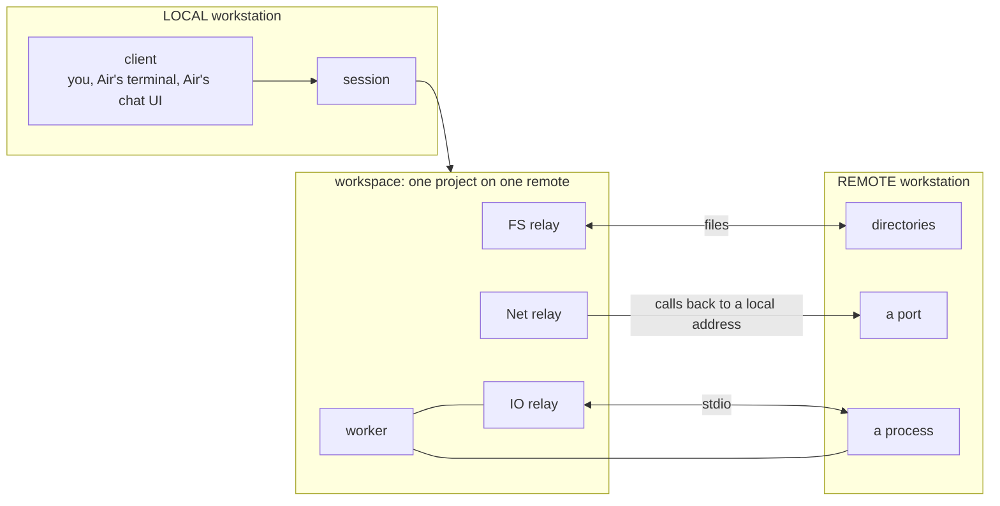
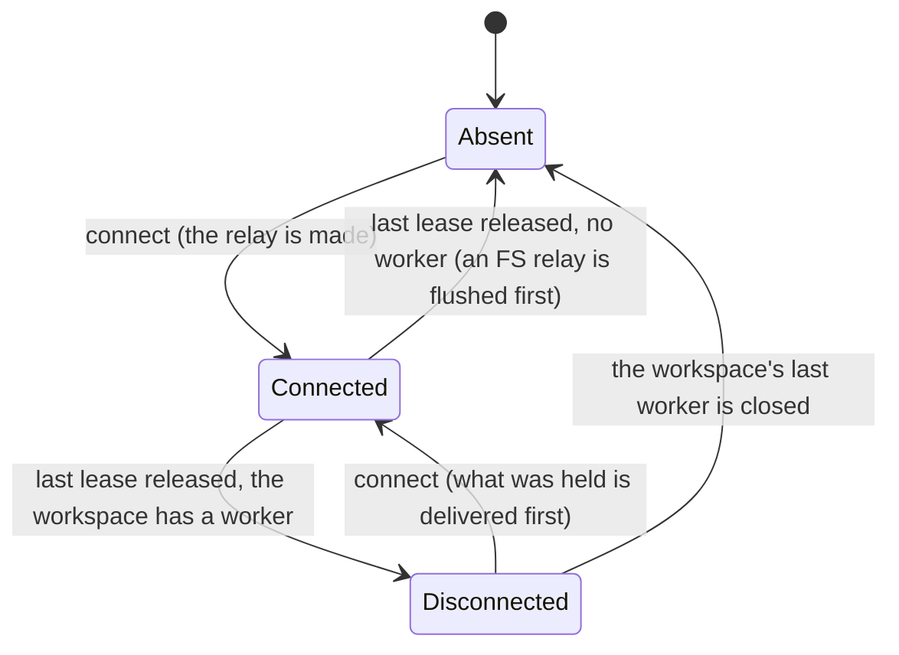
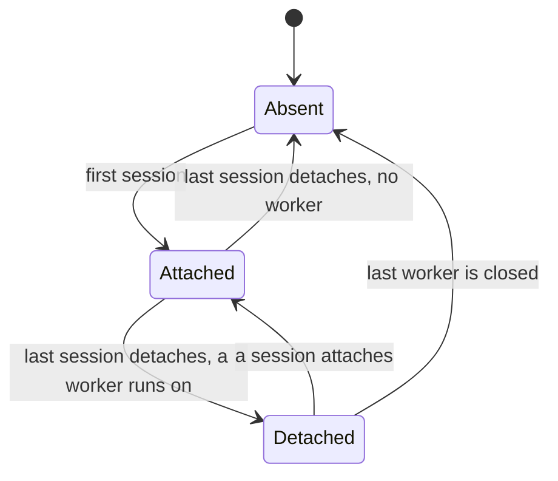
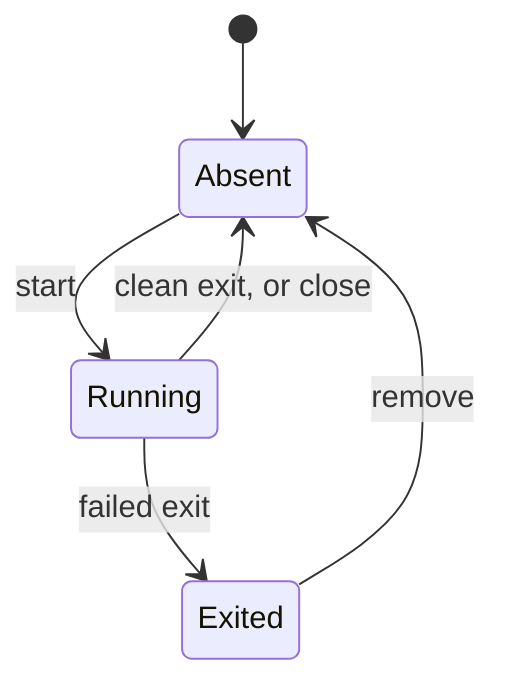
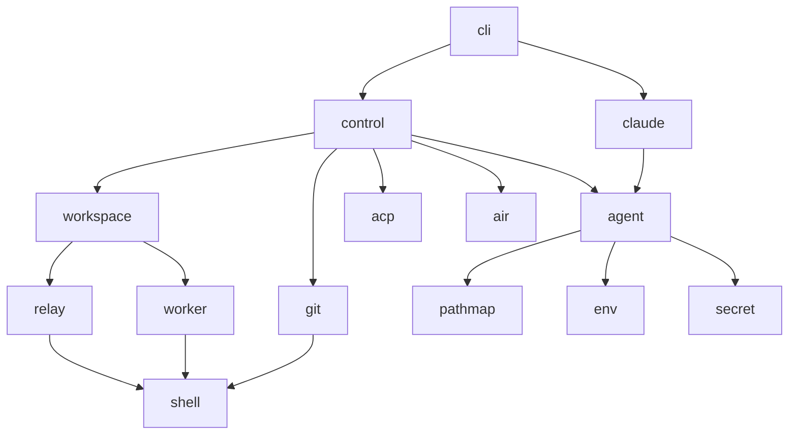
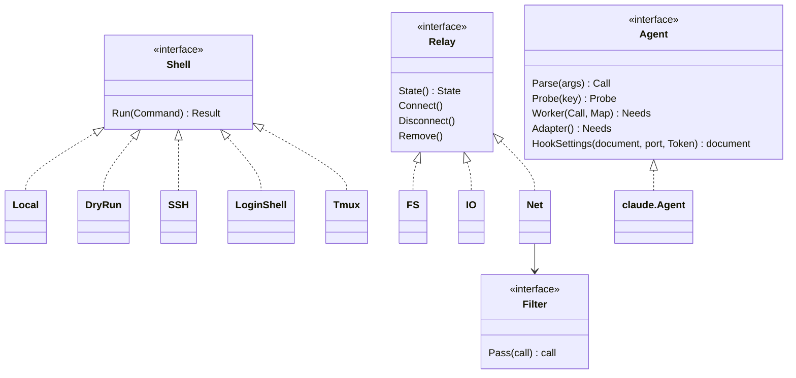
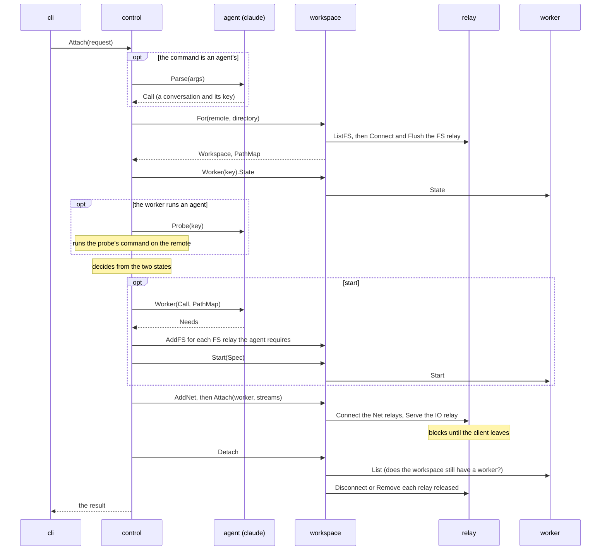
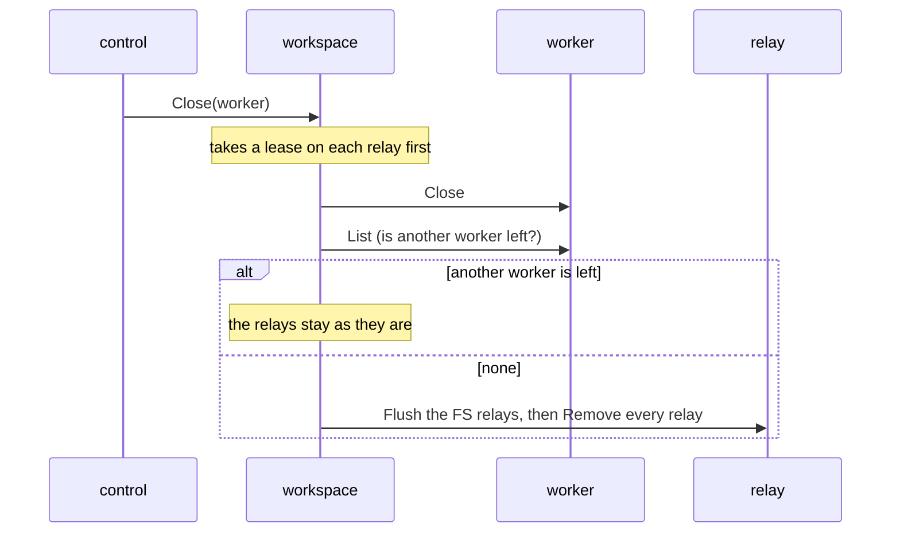
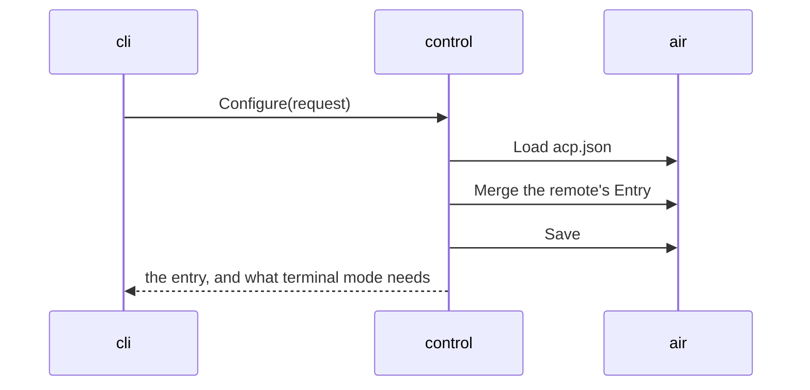

# Hermod — Architecture

This document is the source of truth for **what Hermod is built from**: its entities and their states, the
packages, the types and interfaces each package declares, and which package calls which in every flow. The README
covers what Hermod does for the user. The rules an entity follows and the reasons behind them are in the
[`add-air-bridge` design](../openspec/changes/add-air-bridge/design.md), which this document links to instead of
restating.

Hermod is small on purpose. It composes Mutagen, ssh and tmux, and for JetBrains Air the ACP adapter, into one
command, and keeps no state of its own.

## The model

> A **session** attaches a local client to a **workspace** on a remote: the **relays** that carry files, stdio and
> calls between the two workstations, and the **workers** that keep running there when the client is gone.



## Entities

Every entity owns one fact, and one package owns the entity. No other package restates that fact or decides by it.

| Entity      | The one fact it owns | Identified by | Lives until | Declared in |
|-------------|----------------------|---------------|-------------|-------------|
| Workstation | A machine commands run on: the local one, or the remote | its host | — | `shell` (`Shell`) |
| Session     | One attachment of a local Hermod process to one workspace and one of its workers | the process and the workspace | the process ends or releases it | `control` (a running use case; no type is stored) |
| Workspace   | The relays and the workers of one project on one remote | the two ends of its project FS relay | it has no worker and no session | `workspace` |
| Relay       | One channel between the two workstations, and whether it is connected | its kind and its two ends | no lease holds it and its workspace has no worker | `relay` |
| Worker      | One persistent process on the remote | a key: the agent's session ID, a name, or `acp` for a workspace's adapter | the remote process is gone | `worker` |
| Agent       | One conversation of the agent program, and that program's contract | the agent's own session ID | the client ends the conversation, or the program exits | `agent` (contract), `claude` (implementation) |

### Where each fact is read

Hermod stores none of these. Each is read from the tool that already holds it, every time it is needed.

| Fact | Source | Read by |
|------|--------|---------|
| Which FS relays exist, their ends and whether they sync | Mutagen (`mutagen sync list`, by label) | `relay`, asked by `workspace` |
| Which workers exist, their state and workspace | tmux on the remote (`tmux ls`, by tag) | `worker`, asked by `workspace` |
| Whether a conversation runs | the agent program (`claude agents --json`) | `control`, with the command and the reading `agent` declares |
| Who still uses a relay locally | a file lock per relay | `workspace` |
| What a command was asked to do | its arguments, then the environment | `cli`, once |
| An ACP chat's history and whether the adapter runs it | the adapter (`session/load`, `session/status`) | `control`, through `acp` |

## States

### Relay



| State        | Meaning |
|--------------|---------|
| Absent       | Does not exist. |
| Disconnected | Exists and accepts traffic at the remote end, but delivers nothing. What arrives is held. |
| Connected    | Delivers in both directions. |

| Kind | Carries | Mechanism | What Disconnected holds, and where |
|------|---------|-----------|------------------------------------|
| FS   | files between two directories | a Mutagen session | file changes, on each side's disk |
| IO   | one worker's stdin, stdout and stderr | tmux for a terminal; a FIFO and logs for a line stream | output and the agent's questions: in tmux's screen, or in the logs |
| Net  | calls from a remote port to a local address, optionally through a filter | `ssh -R` to a local listener | nothing: a Net relay goes from Connected to Absent |

The rules for leases and release are in the [design](../openspec/changes/add-air-bridge/design.md#relay).

### Workspace



| State    | Meaning |
|----------|---------|
| Absent   | It has no relay and no worker. |
| Detached | No session holds it: its workers run on and its relays are Disconnected. |
| Attached | A session holds it: the relays that session leases are Connected. |

A workspace's state is computed from its members and never kept. Which workspace a directory belongs to, and how
relays enter one, are in the [design](../openspec/changes/add-air-bridge/design.md#workspace).

### Worker



| State   | Meaning |
|---------|---------|
| Absent  | No tmux session under the key. |
| Running | The process is alive. |
| Exited  | The process failed; its pane is kept to show the error and exit status. |

### Agent


| State   | Meaning |
|---------|---------|
| Running | The agent program lists the conversation as running. |
| Stopped | It does not. |

A detach changes no worker's and no agent's state.

## Packages



Dependencies point one way and no package imports another on its own row. `pathmap`, `env` and `secret` are leaves
that any package above them may use; only the edges that define a layer are drawn.

| Package     | Owns | Declares |
|-------------|------|----------|
| `cli`       | The process's interface: commands, flags, the name of every variable Hermod reads, stdio, the stand-in entry chosen by the program name, and which agent implementation a command gets | the commands; one request per command |
| `control`   | The use cases, and the decisions in them: what to do for a pair of agent and worker states, and how ACP messages are routed | `Attach`, `OneShot`, `Chat`, `Configure`; their request types; `ExitStatus` |
| `workspace` | One project's relays and workers on one remote: which workspace a directory belongs to, the names and labels, the leases, the release rule, the state of the whole, the path map | `Workspace`, `State`, `Members` |
| `relay`     | The three relay kinds behind one state set. Mechanism only | `Relay`, `State`, `FS`, `IO`, `Net`, `Ends`, `Filter` |
| `worker`    | The tmux session on the remote. Mechanism only | `Worker`, `State`, `Spec`, `Form`, `Stdio`, `List` |
| `agent`     | The contract between Hermod and an agent program, as values. No behaviour | `Agent`, `State`, `Call`, `Probe`, `Needs` |
| `claude`    | Claude Code's side of that contract: its arguments, its running state, its launch and its adapter's, its settings documents. Pure functions | `Agent` (implements `agent.Agent`) |
| `acp`       | The ACP wire format: reading and writing messages, and the fields a message is routed by | `Message`, `Conn` |
| `air`       | Air's own facts: the `acp.json` document and the names of Air's own ACP messages | `Config`, `Entry`, `Archive`, `Unarchive` |
| `git`       | The developer's identity, and a linked worktree's main working tree | `Identity`, `Read`, `MainWorktree` |
| `shell`     | Where a command runs and how | `Shell`, `Command`, `Result`; `Local`, `DryRun`, `SSH`, `LoginShell`, `Tmux` |
| `pathmap`   | The map between local and remote roots, applied to a string or a JSON value, and where a local directory lies on the remote | `Map`, `Place` |
| `env`       | Variables as key and value pairs; the one place that splits and joins `KEY=VALUE` | `Vars` |
| `secret`    | A token that prints as a mask | `Token` |

Scripts that run on the remote are files embedded in the package that owns them. Each takes its inputs as
arguments and environment; nothing is substituted into a script's text.

## Interfaces

An interface is declared where it has more than one implementation or where a package must not know who implements
it. Everything else is a concrete type, tested through a fake `Shell`.



### `shell.Shell` — a workstation

One method: run one `Command` and return its `Result`. A `Command` is built once and carries the argv, the
directory, the variables, the streams and how to stop it.

| Implementation | What it is |
|----------------|------------|
| `Local`        | Runs the command on this machine. |
| `DryRun`       | Prints the command as a line that can be pasted, and runs nothing. |
| `SSH`          | Wraps an inner `Shell`: the command runs on a host. |
| `LoginShell`   | Wraps an inner `Shell`: the command runs under the user's login shell. |
| `Tmux`         | Wraps an inner `Shell`: the command runs in a tmux session. |

The first two say **how** a command runs and the other three **where**. A caller nests the ones it needs, and the
choice between `Local` and `DryRun` is made once, at the bottom, so no code above it knows about dry-run. Reads
that shape the plan (states, git identity) always use `Local`.

### `relay.Relay` — one channel

| Method       | What it does |
|--------------|--------------|
| `State`      | Reads the relay's state from its mechanism. A read that fails is an error, not a state. |
| `Connect`    | Makes the relay if Absent, and takes it to Connected. |
| `Disconnect` | Takes it to Disconnected. |
| `Remove`     | Takes it to Absent. |

| Implementation | Constructed from | Adds |
|----------------|------------------|------|
| `FS`  | `Ends` (a local root and a remote root), a name, labels | `Flush`; `ListFS`, which reads the relays under a label with their ends |
| `IO`  | a `worker.Stdio` value and the client's streams | `Serve`, which copies between them until the client leaves |
| `Net` | a remote port, a local address, an optional `Filter` | — |

`relay` connects, disconnects and removes what it is told to. It holds no lease and decides nothing.

### `relay.Filter` — what a Net relay lets through

One method: given a call that arrived on the remote port, return the call to make locally, or refuse it. `relay`
declares it and knows no implementation. `control` builds the one for an agent's hooks from what the agent
declared; a user's `-R` relay has none.

### `agent.Agent` — an agent program's contract

`control` reaches an agent only through this interface, and `cli` chooses the implementation from the command
line. Every method is a question answered with a value; an agent performs nothing.

| Method         | Control asks | The agent answers with |
|----------------|--------------|------------------------|
| `Parse`        | What do these arguments ask for? | a `Call`: a conversation and its key, or a one-shot call |
| `Probe`        | Is this conversation running? | a `Probe`: the command that asks the agent program, and how to read its output into a `State` |
| `Worker`       | What does a worker for this call need? | a `Needs`: the command with paths mapped, the files it must find, the names of the local variables it must be given, and the relays it requires |
| `Adapter`      | What does its ACP adapter need? | a `Needs` of the same shape |
| `HookSettings` | How do its hook settings reach a relay? | the settings document with its hooks aimed at a remote port and carrying the worker's token |

An agent is handed a `pathmap.Map` and never learns where the other workstation is or how it is reached.

### Concrete types

| Type | Operations | Notes |
|------|------------|-------|
| `workspace.Workspace` | `For` (the workspace a directory belongs to, made if there is none), `State`, `PathMap`, `AddFS`, `AddNet`, `Worker`, `Start`, `Attach`, `Detach`, `Close` | The only type that pairs relays with workers. `Detach` and `Close` apply the release rule. Leases are its own detail. |
| `worker.Worker` | `State`, `Start`, `Close`, `Remove`, `Stdio`; `List` by tag | `Spec` says what to start: key, directory, command, files, variables, tags and the IO `Form` (terminal or line stream). |
| `acp.Conn` | `Read`, `Write` | One message per line. A `Message` gives its method, its ID, the chat it belongs to and the directory it names, and takes a `pathmap.Map`. |
| `air.Config` | `Load`, `Merge`, `Save` | Merging keeps every entry and key it does not own. |
| `pathmap.Map` | `ToRemote`, `ToLocal` | Built from the ends of a workspace's FS relays, longest prefix first. |

## Flows

The steps and their rules are in the [design](../openspec/changes/add-air-bridge/design.md#flows). The diagrams
here show which package does each step.

### Session: `hermod attach`, and `claude` on a terminal



### One-shot call


No workspace, no worker and no relay take part.

### Chat: `hermod air acp`

```mermaid
sequenceDiagram
    participant Air
    participant control
    participant acp
    participant agent as agent (claude)
    participant workspace
    participant adapter as adapters on the remote

    Air->>control: starts Chat(request) through cli
    control->>agent: Adapter()
    agent-->>control: Needs
    control->>adapter: starts its own adapter over ssh (no worker)

    Air->>control: initialize
    control->>acp: Read, drop the fs and terminal capabilities
    control->>adapter: initialize, to its own adapter
    adapter-->>Air: the answer

    Air->>control: session/new (a directory)
    control->>workspace: For(remote, directory)
    control->>workspace: Worker(acp).State
    opt Absent
        control->>workspace: Start(Spec for the adapter), AddNet for its hooks
        control->>adapter: the kept initialize
    end
    control->>workspace: Attach(worker, a line stream)
    control->>adapter: session/new, paths mapped to the remote
    adapter-->>control: answer and updates
    control-->>Air: the same, paths mapped back, requests renumbered

    Air->>control: session/close (a closed tab)
    control-->>Air: the answer; nothing is passed on
    opt it was the workspace's last open chat
        control->>workspace: Detach (the Net relay is kept)
    end

    Air->>control: _session/archive (mark done)
    control->>adapter: session/close, then the archive
    opt the adapter runs no other chat
        control->>workspace: Close(worker)
    end

    Air->>control: stdin EOF or SIGTERM
    control->>workspace: Detach, for every workspace it holds
```

`control` holds one session per workspace that has a chat open and keeps, only while it runs, which chat belongs
to which workspace and which request ID it gave to which adapter. Neither is stored: after a restart a chat's
workspace is found again from the directory its `session/load` names.

### Close



### Registration: `hermod air configure`



## The command-line seam

`cli` is the only package that reads the process: its arguments, its environment, its streams and the name it was
started under. It resolves each value once, an argument winning over its variable, builds one request, picks the
agent implementation the command names, and calls one use case. Started as `claude`, the binary builds the same
request `hermod attach -- claude ARGS…` builds. No package below `cli` imports the command-line framework or looks
at the environment.
